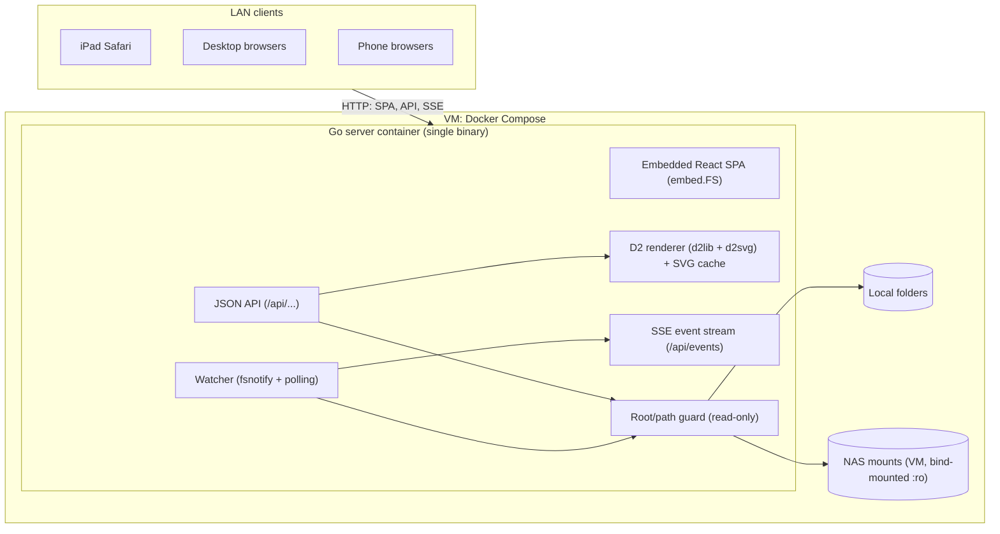
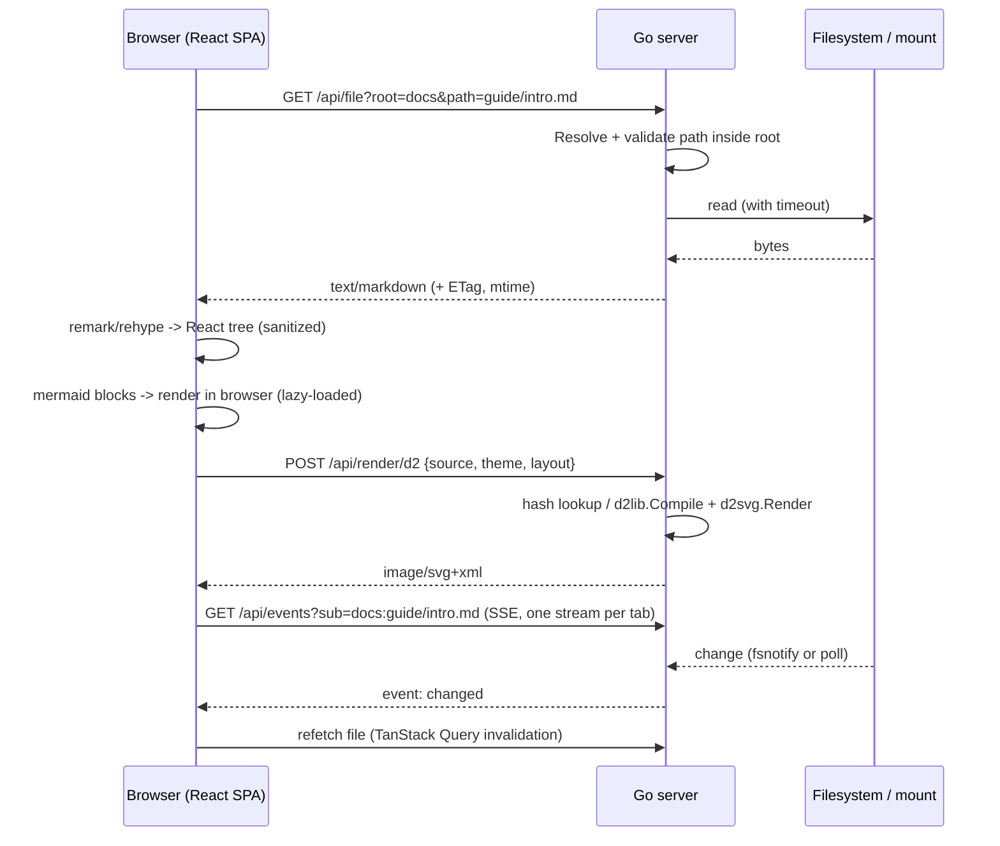

# Project Architecture

## Purpose

High-level architecture for the LAN Markdown viewer. Detailed API contracts and module layout are finalized in the planning phase ([Implementation Plan](./Implementation.md)). This document reflects the Go backend chosen in [Tech Stack](./Tech-Stack.md).

## System Diagram



## Request Flow: Viewing A Markdown File



## Components

| Component          | Responsibility                                                                                                                                                                                                                                                                                                                                                                                                                                                                                                                                                                                                                                                                                                                                                                                                                                                                                                                                                                                                                                                                                                                                                                                           |
| ------------------ | -------------------------------------------------------------------------------------------------------------------------------------------------------------------------------------------------------------------------------------------------------------------------------------------------------------------------------------------------------------------------------------------------------------------------------------------------------------------------------------------------------------------------------------------------------------------------------------------------------------------------------------------------------------------------------------------------------------------------------------------------------------------------------------------------------------------------------------------------------------------------------------------------------------------------------------------------------------------------------------------------------------------------------------------------------------------------------------------------------------------------------------------------------------------------------------------------------- |
| Config             | Loads roots (name → absolute path), listen address, poll interval, size limits, and per-root mount hints (watch vs. poll) from environment variables only.                                                                                                                                                                                                                                                                                                                                                                                                                                                                                                                                                                                                                                                                                                                                                                                                                                                                                                                                                                                                                                               |
| Root/path guard    | Built on Go `os.Root` (`OpenRoot`, then `Open`/`Stat`/`Lstat`/`ReadDir` via the root). `Resolve(rel)` lexical prechecks produce the 400 cases (raw `..` anywhere, absolute, backslash, NUL/control/bidi characters, too long). Symlink escapes are detected from `os.Root`'s own error (403, fail-closed to 500 if Go changes it). Special files (FIFO, device, socket) are refused with 403 via `O_NONBLOCK` + fstat. Permission denied is 403; ELOOP and ENOTDIR are 404. Errors carry `PublicMessage()`, the only text safe for clients. Every file access goes through this. Per-root in-flight fs-op cap: callers wait for a slot up to `MDV_FS_TIMEOUT`, and a wait that expires is `fs_timeout` but does not mark the root unavailable; a root that times out is marked `unavailable` and probed with one stat at a time. Caller cancellation is reported as `fs_timeout` but does not mark the root unavailable. Listing a non-directory is 400. A not-found path is retried once in its alternate NFC/NFD form. File bodies are read through `Handle.Reader`, which runs each `ReadAt` under the same timeout and in-flight slot, so a mount that dies after `Open` cannot hang `ServeContent`. |
| Listing API        | Directory entries with type, size, mtime. No pagination in MVP: capped at `MDV_MAX_LIST_ENTRIES` with a `truncated` flag. Applies timeouts.                                                                                                                                                                                                                                                                                                                                                                                                                                                                                                                                                                                                                                                                                                                                                                                                                                                                                                                                                                                                                                                              |
| File API           | Serves raw bytes by allowlist (raster images and text kinds only), with ETag/Last-Modified and range support for media. Everything else, including SVG/HTML, is an attachment or sandboxed.                                                                                                                                                                                                                                                                                                                                                                                                                                                                                                                                                                                                                                                                                                                                                                                                                                                                                                                                                                                                              |
| D2 renderer        | Compiles D2 source to SVG with dagre/ELK, with an empty `fs.FS` (no imports). Bounded concurrency (slot held until the render goroutine returns) and timeout per render. LRU cache keyed by hash (including compile errors and timeouts), bounded by entry count (`MDV_D2_CACHE_ENTRIES`) and 64 MiB total; SVGs over 4 MiB are not cached.                                                                                                                                                                                                                                                                                                                                                                                                                                                                                                                                                                                                                                                                                                                                                                                                                                                              |
| Watcher + SSE      | One stream per tab carrying many subscriptions. Uses fsnotify on local disks and mtime polling on network mounts. Sends coalesced change events.                                                                                                                                                                                                                                                                                                                                                                                                                                                                                                                                                                                                                                                                                                                                                                                                                                                                                                                                                                                                                                                         |
| SPA: Shell         | Layout, theme, responsive sidebar drawer, routing (`/view/:root/*`).                                                                                                                                                                                                                                                                                                                                                                                                                                                                                                                                                                                                                                                                                                                                                                                                                                                                                                                                                                                                                                                                                                                                     |
| SPA: Browser       | Root list, folder listing, breadcrumbs, filter, workspace tree.                                                                                                                                                                                                                                                                                                                                                                                                                                                                                                                                                                                                                                                                                                                                                                                                                                                                                                                                                                                                                                                                                                                                          |
| SPA: Document view | Markdown pipeline, link/image rewriting, TOC, Mermaid and D2 diagram components, error boundaries.                                                                                                                                                                                                                                                                                                                                                                                                                                                                                                                                                                                                                                                                                                                                                                                                                                                                                                                                                                                                                                                                                                       |

## Repository Layout

Go module: `github.com/awesomejt/markdown-viewer`. Binary: `mdv`.

```text
cmd/mdv/main.go            # entrypoint: load config, build server, graceful shutdown
internal/config/           # env config parsing, validation
internal/fsroot/           # Root registry, path guard, listing, file reads with timeouts
internal/d2render/         # D2 compile/render, LRU cache, concurrency limit
internal/watch/            # fsnotify + mtime poller, subscription hub
internal/api/              # HTTP handlers, error model, middleware (slog, recover)
internal/web/              # embed.FS of web/dist + SPA fallback handler
web/                       # Vite + React + TypeScript SPA
  src/api/                 # typed API client + TanStack Query hooks
  src/app/                 # shell, routes, theme, layout
  src/browse/              # roots, listings, breadcrumbs, workspace tree
  src/markdown/            # remark/rehype pipeline, link rewriting, components
  src/diagrams/            # Mermaid + D2 components
  src/live/                # EventSource subscription
e2e/                       # Playwright tests + fixture tree (testdata/)
testdata/fixtures/         # shared Markdown/diagram/symlink fixtures
Dockerfile, compose.yaml, .dockerignore
Makefile                   # build, test, lint, check, docker, e2e
```

## Configuration

Environment variables only, set in `compose.yaml`. A config file is deferred (D-20).

| Variable               | Default      | Meaning                                                                                                                                                                                                                                                                                                          |
| ---------------------- | ------------ | ---------------------------------------------------------------------------------------------------------------------------------------------------------------------------------------------------------------------------------------------------------------------------------------------------------------- |
| `MDV_LISTEN`           | `:8080`      | Listen address.                                                                                                                                                                                                                                                                                                  |
| `MDV_ROOTS`            | _(required)_ | Comma-separated `name=/abs/path[:watch]` entries. `watch` is `poll` (default) or `fsnotify`. Example: `markdown=/data/markdown,notes=/data/notes:fsnotify`. Names match `^[a-z0-9][a-z0-9_-]{0,31}$`.                                                                                                            |
| `MDV_POLL_INTERVAL`    | `2s`         | mtime polling interval for `poll` roots.                                                                                                                                                                                                                                                                         |
| `MDV_FS_TIMEOUT`       | `5s`         | Timeout for any single filesystem operation (dead mounts).                                                                                                                                                                                                                                                       |
| `MDV_FS_MAX_INFLIGHT`  | `4`          | Per-root cap on concurrent filesystem operations. Callers wait for a slot up to `MDV_FS_TIMEOUT`; a wait that expires is 504 `fs_timeout` but does not mark the root unavailable.                                                                                                                                |
| `MDV_MAX_LIST_ENTRIES` | `20000`      | Maximum entries returned by `/api/list`; beyond it the response sets `"truncated": true`.                                                                                                                                                                                                                        |
| `MDV_MAX_FILE_BYTES`   | `5242880`    | Maximum size served by `/api/file` without `?force=1` (applies to text kinds only; media streams).                                                                                                                                                                                                               |
| `MDV_D2_TIMEOUT`       | `10s`        | Per-render timeout.                                                                                                                                                                                                                                                                                              |
| `MDV_D2_CONCURRENCY`   | `2`          | Concurrent D2 renders.                                                                                                                                                                                                                                                                                           |
| `MDV_D2_CACHE_ENTRIES` | `256`        | LRU cache size for rendered SVG.                                                                                                                                                                                                                                                                                 |
| `MDV_LOG_LEVEL`        | `info`       | `debug`, `info`, `warn`, `error`.                                                                                                                                                                                                                                                                                |
| `MDV_ALLOWED_HOSTS`    | _(none)_     | Comma-separated extra `Host` hostnames to accept (DNS rebinding guard). IP literals and `localhost` are always allowed and the port is ignored. Non-ASCII names must be given in punycode (`xn--`) form. Other hosts get 421 `host_not_allowed`. `*` alone disables the check (reverse proxies; logs a warning). |

Startup fails fast on a syntax error (bad or duplicate name, relative path) or a root path that exists but is not a directory. A root that is missing, errors, or does not answer within `MDV_FS_TIMEOUT` at boot (for example a NAS that is not up yet) does not stop startup: roots are opened lazily and checked concurrently, the root starts `available:false`, a warning is logged, and the usual recovery probe opens it once it answers, with no restart. If a mount point directory exists but the share is not yet mounted, the open succeeds on the empty directory. While the root is in use, at most once every 2 s a call compares the device and inode of the configured path (`stat`) with the open directory and reopens the root when they differ, so a later mount or unmount is picked up without a restart. The replaced `os.Root` is retired, not closed, because calls may still use it; it is closed at the next swap or shutdown (FIX-16).

Commands: `mdv` or `mdv serve` runs the server (graceful shutdown on SIGINT/SIGTERM, 10 s drain); `mdv version` prints the version; `mdv healthcheck` GETs `/healthz` on loopback at the `MDV_LISTEN` port (3 s timeout, exit 0 only on 200 `{"status":"ok"}`, else 1) and does not read `MDV_ROOTS`.

## HTTP API Contract

All `/api` responses except raw file bodies, SVG, and SSE are JSON. `path` is always relative to the root, uses `/` separators, and `""` means the root itself. The server never returns host paths.

**Error model:** non-2xx JSON responses use `{"error": {"code": "<code>", "message": "<human text>"}}`.

| HTTP | `code`                   | When                                                                                                                                                                                                                  |
| ---- | ------------------------ | --------------------------------------------------------------------------------------------------------------------------------------------------------------------------------------------------------------------- |
| 400  | `bad_request`            | Missing or invalid parameters, malformed path, or more than 32 `sub` values on `/api/events`.                                                                                                                         |
| 403  | `forbidden`              | Path escapes the root (traversal or symlink).                                                                                                                                                                         |
| 404  | `not_found`              | Unknown root or path.                                                                                                                                                                                                 |
| 413  | `too_large`              | Text file over `MDV_MAX_FILE_BYTES` without `force=1`, or D2 source over 256 KiB (enforced with `http.MaxBytesReader` before JSON decode).                                                                            |
| 415  | `unsupported_media_type` | `POST /api/render/d2` without `Content-Type: application/json`.                                                                                                                                                       |
| 421  | `host_not_allowed`       | `Host` header is not an IP literal, `localhost`, or in `MDV_ALLOWED_HOSTS`.                                                                                                                                           |
| 422  | `render_error`           | D2 compile failure (including attempted imports). The message includes the D2 error text, which contains line/column.                                                                                                 |
| 503  | `busy`                   | No D2 render slot became free within 1 s.                                                                                                                                                                             |
| 504  | `fs_timeout`             | Filesystem operation exceeded `MDV_FS_TIMEOUT`, or no in-flight slot (`MDV_FS_MAX_INFLIGHT`) freed within that time (this wait does not mark the root unavailable), or the root is `unavailable` (fails immediately). |
| 504  | `render_timeout`         | D2 render exceeded `MDV_D2_TIMEOUT`.                                                                                                                                                                                  |
| 500  | `internal`               | Anything else. Details are logged, not returned.                                                                                                                                                                      |

### Endpoints

| Method & path                         | Response                                                                                                                                                                                                                                                                                                                                                                                                                                                                                                                                                                                                                                                                                                                                |
| ------------------------------------- |-----------------------------------------------------------------------------------------------------------------------------------------------------------------------------------------------------------------------------------------------------------------------------------------------------------------------------------------------------------------------------------------------------------------------------------------------------------------------------------------------------------------------------------------------------------------------------------------------------------------------------------------------------------------------------------------------------------------------------------------|
| `GET /healthz`                        | `200 {"status":"ok"}`. Never touches roots, so a dead mount cannot fail the healthcheck.                                                                                                                                                                                                                                                                                                                                                                                                                                                                                                                                                                                                                                                |
| `GET /api/roots`                      | `{"roots":[{"name":"markdown","watch":"poll","available":true}]}`. `available` is false after a filesystem timeout, or when the root could not be opened at startup, until a probe stat succeeds.                                                                                                                                                                                                                                                                                                                                                                                                                                                                                                                                       |
| `GET /api/list?root=&path=`           | `{"root","path","truncated":false,"entries":[{"name","type":"dir\|file","kind","size","mtime"}]}`. `kind` is one of `markdown` (`.md`, `.markdown`, `.mdx`), `diagram` (`.mmd`, `.mermaid`, `.d2`), `image` (`png jpg jpeg gif webp svg avif`), `text` (known text/code extensions), `other`. `mtime` is RFC 3339. Dot-files are included, and the client filters them. Symlinks are resolved and reported as their target type, and omitted if they escape the root. Sorted dirs first, then by name (case-insensitive). No pagination: at most `MDV_MAX_LIST_ENTRIES` entries are returned and `truncated` is true when more exist.                                                                                                   |
| `GET /api/file?root=&path=[&force=1]` | Raw bytes via `http.ServeContent` (Range, `If-None-Match`, `Last-Modified`). Each body chunk (≤ 32 KiB) gets a fresh 10 s write deadline, so a client that stops reading releases the handler and file descriptor. `ETag` is `mtimeNs-size-ino`, and the response sends `Cache-Control: no-cache`. Allowlist serving (see below). Every response sets `X-Content-Type-Options: nosniff` and `Content-Security-Policy: sandbox; default-src 'none'; style-src 'unsafe-inline'; img-src data:`.                                                                                                                                                                                                                                           |
| `POST /api/render/d2`                 | Request `{"source": "...", "theme": "light\|dark", "layout": "dagre\|elk"}`. `layout` defaults to `dagre` (only `dagre` is required in MVP). Request must be `Content-Type: application/json` (else 415 `unsupported_media_type`); cross-origin requests get 403 (`http.CrossOriginProtection`). Response is `image/svg+xml`; every response carries the `fileCSP` sandbox CSP and `nosniff`. The cache key is sha256 over the D2 version, layout, theme and source (see D2 Safety). Compile errors and timeouts are cached too (negative cache). The POST response sets no `Cache-Control`. Body is limited to 256 KiB with `http.MaxBytesReader` before JSON decode. See D2 Safety.                                                   |
| `GET /api/events?sub=<root>:<path>`   | SSE stream, one per browser tab. `sub` is repeatable (max 32 per stream, else 400). Each `path` may be a file, a directory, or not exist yet; a directory watch covers its direct children. Events: `event: change` with `data: {"root":"<root>","path":"<rel>","op":"modified\|created\|deleted"}`. Only GET opens a stream; HEAD and other methods get `405` with `Allow: GET`. The stream starts with a `: open` comment (so every browser fires `open` at once) and a `: ping` comment is sent every 25 s. Events are coalesced per `(root, path)` within 250 ms. The client reopens the stream when its subscription set changes.                                                                                                  |
| `GET /*`                              | Embedded SPA assets. Misses under `/assets/` and `/api/` return 404, never `index.html`. Other unknown paths return `index.html` (history routing). `index.html` is sent with `Cache-Control: no-cache`; hashed assets with `public, max-age=31536000, immutable`. Other static files (favicon, icons, `manifest.webmanifest`) are `no-cache`; `.webmanifest` is served as `application/manifest+json` (missing from Go's MIME table). Only GET and HEAD are allowed (else 405). Directories are never listed. If the bundle has no `index.html` (not built), non-asset paths return a plain-text `503 web UI not built`.                                                                                                               |

### File Serving (Allowlist)

| Class           | Extensions                                        | Served as                                                                                           |
| --------------- | ------------------------------------------------- | --------------------------------------------------------------------------------------------------- |
| Raster images   | `png jpg jpeg gif webp avif`                      | Their image MIME type.                                                                              |
| Text kinds      | Markdown, diagram, and known text/code extensions | `text/plain; charset=utf-8`.                                                                        |
| SVG             | `svg`                                             | `image/svg+xml` only together with the sandbox CSP above, for `` use. Otherwise an attachment. |
| Everything else | `html htm xhtml xml xsl shtml`, unknown           | `application/octet-stream` with `Content-Disposition: attachment`.                                  |

### D2 Safety

- Compile with an explicit empty `fs.FS` so D2 file imports cannot read the host. **Verified in D2 v0.9.0:** `d2lib.CompileOptions.FS` is passed through `d2compiler` to `d2ir`, which calls `os.Open` on the import path when `FS` is nil and `FS.Open` otherwise. A nil FS would therefore read the host, so `internal/d2render` always sets a custom empty `fs.FS` (every `Open` returns `ErrNotExist`). Tests assert that `@../../etc/passwd`, `...@x`, `@/etc/passwd`, `@x.d2` and imports inside maps all fail with a compile error (422).
- Themes: `light` (default when empty) is Neutral Default, ID 0; `dark` is Dark Mauve, ID 200. Layouts: `dagre` (default) and `elk`. Anything else is 400 `bad_request`.
- The concurrency slot is held until the render goroutine actually returns, because dagre ignores `ctx`. A request waits at most 1 s for a slot, else `503 busy`. A render timeout (wall clock, also passed to Compile as a context deadline) returns `504 render_timeout`.
- Each slot owns its own `textmeasure.Ruler` (created lazily), because Ruler concurrency safety is unverified. A Ruler is never shared between concurrent renders.
- Cache key: sha256 over length-prefixed (D2 version constant, layout, theme ID, source). Successes, compile errors and timeouts are cached; busy, bad-request, caller-cancelled and internal errors are not. Identical concurrent requests share one render (hand-rolled singleflight), and the render runs detached from any single caller's context, so a cancelled client cannot poison the cache. The cache is bounded by entry count (`MDV_D2_CACHE_ENTRIES`) and 64 MiB total; SVGs over 4 MiB are not cached (still returned to the caller).

### Watch Semantics

- The hub reference-counts subscriptions per `(root, path)` and stops watching when the last subscriber disconnects.
- `poll` roots: every `MDV_POLL_INTERVAL`, directories poll one `ReadDir` name set plus the directory's own mtime (no per-child stat). Files poll stat size + mtime (ns) + inode. All stats go through `MDV_FS_TIMEOUT` and the per-root in-flight cap. The poller skips a path whose previous stat is still pending.
- NAS attribute caching (CIFS `actimeo`, NFS `acdirmax`) can delay change visibility. DOC1 documents this and recommends low values for live reload.
- SSE robustness: each stream uses `http.ResponseController` to replace the server write deadline with a fresh 10 s deadline before every event batch and every ping (a write error or missed deadline ends the stream, so a client that stops reading cannot hold the handler forever), and flushes after every event. On `visibilitychange` to visible and on each EventSource `open`, the client invalidates its active queries (iPad backgrounding drops streams).
- Live client (`src/live/`): `LiveProvider` (inside the `QueryClientProvider`) owns the tab's single EventSource through a `LiveController`. Views call `useLiveSubscription(root, path)` (file views subscribe to their file, folder views to their folder; each root-relative image in a Markdown document subscribes to its image file with low priority). The controller ref-counts and de-duplicates `root:path` keys, sorts and caps them at 32 (low-priority keys only fill the slots the others leave, so a document with many images keeps its own subscription), debounces changes (50 ms) so navigation does not churn connections, and keeps no stream while the set is empty. A CLOSED stream (non-200, e.g. 503) is reopened with capped exponential backoff (1 s to 30 s, jittered, reset on `open`); CONNECTING errors are left to the browser. On `change` it invalidates the file query, the parent listing (the `/view` kind depends on it) and the path's own listing; on `open` and on visible it invalidates active `roots`/`list`/`file` queries only. A deleted file's refetch 404s into the normal error state and recovers on `created`. Markdown re-renders keep the heading nearest the viewport top at the same offset (snapshot in render, restore in a layout effect), falling back to the previous scrollTop; refetches keep the previous data, so there is no loading flash.
- `fsnotify` roots: an inotify watch on the path, or on the parent directory for files, to catch editors that write via rename.
- Directory event scheme (both modes): a child appearing or disappearing is `created` or `deleted` on the child's path, and the directory itself gets `modified` (its mtime changed). A change to a child's content does not touch the directory's mtime, so it is seen only by subscribing to the child. The directory itself vanishing or reappearing is `deleted` or `created` on its own path. A file replaced by rename-over is `modified`.
- Missing paths: a `sub` whose path does not exist is accepted, because an EventSource treats any non-200 as fatal and a file being re-saved or deleted must not kill live reload. It starts from a \"not present\" baseline and its creation is reported as `created`. `poll` roots need nothing else. `fsnotify` roots watch the parent directory, which must exist and be a directory (else 404). Unknown root stays 404, a malformed path 400, an escaping path 403.
- Kind swaps (`poll`): the poller follows the path's current kind. A file replaced by a directory, or the reverse, is reported as `modified` on the path itself (`deleted` then `created`, merged) with no per-child events, and polling continues in the new mode. `fsnotify` re-arms deleted-then-recreated directories: when a watched host directory (the path itself, or a file's parent) is removed or renamed away, its kernel watch is dropped and the key waits on the nearest existing ancestor, never above the root, stepping down as intermediate directories reappear. The recreated path is re-validated through the guarded `Handle` and must be a real directory (an escaping symlink is never re-armed) before the watch is re-added, off the reader goroutine. To close the race, a re-armed directory key gets `modified` (plus `created` if it was reported deleted) and a file key gets `created` if the file now exists.
- Watch cap: the hub holds at most `MaxWatches` distinct `(root, path)` keys whose path exists (default 256), and separately at most `MaxMissing` keys whose path did not exist when first watched (default 64), so a flood of missing-path subs cannot lock out valid ones. A key stays in the missing count for its entry's whole life, even after the path appears. A `Subscribe` that would exceed either cap registers nothing and fails with `ErrTooManyWatches`, which `/api/events` maps to `503 busy`. Keys that are already watched do not count as new.
- Stream cap: `/api/events` allows at most 64 concurrent streams in total and 16 per client IP, taken from the TCP peer address (`X-Forwarded-For` is ignored, as clients can forge it). Over either cap the response is `503 busy`. Behind a reverse proxy all clients share the proxy's IP, so they share the per-IP cap. A slot is held until the handler returns.
- Poll outages: a poll that times out or hits an unavailable root keeps the previous state, so an outage never reports a deletion. A path is never polled twice concurrently.
- `fsnotify` host paths: the path is validated through the guarded `Handle` (`Stat` via `os.Root`) before being joined to the root's host directory; host paths never appear in events, errors or client-visible logs. All fsnotify keys share one inotify instance, with kernel watches refcounted per host directory.
- Shutdown: `api.Server.Close` closes the hub and ends every open stream. `cmd/mdv` registers it with `http.Server.RegisterOnShutdown`, so `Shutdown` does not wait out the drain timeout for SSE connections. New streams after that get `503 busy`.

## Frontend Routes

| Route                               | View                                                                                   |
| ----------------------------------- | -------------------------------------------------------------------------------------- |
| `/`                                 | Root list.                                                                             |
| `/browse/:root/*`                   | Folder listing for the path.                                                           |
| `/view/:root/*`                     | File view chosen by kind: Markdown document, diagram page, image, text, or download.   |
| `?ws=<rel-folder>` (on browse/view) | Workspace mode: sidebar tree anchored at that folder, kept while navigating within it. |
| `#<slug>`                           | Heading anchor within a document.                                                      |

**Link rewriting in Markdown:**

- A relative `.md`/diagram link becomes `/view/:root/<resolved>` with `ws` preserved, or dropped when the target is outside the workspace folder.
- A relative directory link becomes `/browse/...`.
- A relative image or other asset becomes `/api/file?root=&path=<resolved>`.
- Absolute `http(s)`/`mailto` links are left unchanged and open in a new tab.
- Links that resolve outside the root are rendered as plain text with a warning title.

**Path encoding:** the client encodes each path segment with `encodeURIComponent`. On not-found, the server retries the NFC/NFD alternate form of the requested path (Mac SMB writes NFD names).

**Markdown pipeline order (exact):** remark-gfm, remark-frontmatter, rehype-raw, rehype-sanitize (schema allows a `language-*` class on `code`), rehype-slug, then Shiki. Mermaid and D2 blocks are detected in the `code` component after sanitizing. Raw-HTML `id` values stay `user-content-` prefixed, while `[x](#heading)` links resolve to slugs.

**Markdown details (F3):**

- `remarkRehypeOptions.clobberPrefix` is `''` so sanitize prefixes footnote ids exactly once; the `a` component prefixes `#` hrefs of footnote ref/backref links with `user-content-` (only `#` hrefs; other hrefs go through `resolveLink`).
- A leading `/` in a link is root-relative. Blocked links (outside the root, non-`http(s)`/`mailto` schemes, `//host`, encoded `/`, `\` or NUL, empty href) render as `span.link-blocked`; outside-root ones carry a warning `title`.
- Relative non-document links open `/api/file` in a new tab (served with a sandbox CSP). Images get `loading="lazy"` and `referrerPolicy="no-referrer"`. A root-relative image's URL carries `v=<mtime>-<size>` from its folder listing (held back until that listing settles, plain URL if it fails or omits the image), so a live change or a missing image appearing reloads it (FIX-18).
- Anchor scroll runs on load and hash change: `getElementById(id)`, then `user-content-<id>`.
- Heading slugs are unprefixed (by design), so a heading can reuse an app id such as `root`; app code must not read optional `window.*` globals (DOM clobbering).
- `MarkdownView` is a lazy chunk; Mermaid/D2 blocks render through the `Diagram` component (see F4 details).

**Highlighting details (F3b):**

- Shiki runs in the `pre` component, after sanitize, as the last step; the remark/rehype plugin order is unchanged and `@shikijs/rehype` is not used. `CodeBlock` shows the plain `pre > code` first, then swaps in the highlighted tree. Unknown or missing languages, and any load or highlight error, keep the plain block.
- `shiki/core` with the JavaScript regex engine (no WASM) and the themes load through a singleton dynamic `import()`; each language is a literal `import('@shikijs/langs/<id>')` from a fixed map (with aliases such as `ts`, `sh`, `yml`), loaded only when a block uses it. Blocks without a language never load Shiki.
- Dual themes (`github-light` and `github-dark`, `defaultColor: 'light'`) emit CSS variables; `:root[data-theme='dark']` selects `--shiki-dark` and `--shiki-dark-bg`, so a theme switch needs no re-highlighting.
- `codeToHast` output is converted with `hast-util-to-jsx-runtime` (no `dangerouslySetInnerHTML`), so code stays text nodes. Results are cached per (class, code) in a bounded map.

**Copy button and front matter panel (R2.2):**

- Every fenced (or indented) code block that is not a diagram sits in a `.code-block` wrapper with a `CopyButton` in its top-right corner, with or without a language. It copies the code text without its trailing newline and shows "Copied" or "Copy failed" for 2 s.
- `copyText` uses `navigator.clipboard.writeText` only in a secure context. mdv is usually opened over plain HTTP on the LAN, where `navigator.clipboard` does not exist, so it falls back to a selected off-screen `<textarea>` and `document.execCommand('copy')` (also used when the async call rejects).
- `extractFrontMatter` mirrors remark-frontmatter's `yaml` fences (`---` on the first line, a closing `---` line). Non-blank front matter shows as a collapsed `<details class="front-matter">` with the raw YAML as text, placed above (outside) `.markdown-body`, so it is never body text. It is not parsed.

**Diagram details (F4):**

- Both kinds display as `` built from the SVG (`image/svg+xml`), inside `figure.diagram[data-diagram][data-state=loading|ready|error]`. Rendered SVG is never shown in the app DOM (Mermaid briefly attaches its DOMPurify-sanitized SVG to measure it under `securityLevel: 'strict'`, then removes it), and object URLs are revoked when replaced and on unmount.
- Mermaid is a dynamic `import('mermaid')` (its own chunk), initialized before every render with `securityLevel: 'strict'`, `htmlLabels: false` (also under `flowchart`), `suppressErrorRendering` and the current theme (`default` or `dark`). Renders go through one module-level promise queue because Mermaid is not reentrant, and leftover temp elements are removed after a failure.
- `useResolvedTheme()` reads `data-theme` on `<html>` through a `MutationObserver`; diagrams re-render (Mermaid) or refetch (D2) when it changes.
- D2 uses `renderD2` (`POST /api/render/d2` with `{source, theme}`) via `useQuery` with key `['d2', theme, source]`, `retry: shouldRetry` (503/504 retried, 4xx not) and `staleTime: Infinity`. A 422 shows the server message; other failures show a generic message with the error code.
- Errors render as `.diagram-error` (title, message as text, source in `pre > code`). Each diagram sits in an error boundary, so a crash shows the same box and never breaks the page.
- Standalone `.mmd`, `.mermaid` and `.d2` files render full page through the lazy `DiagramPage`.

**Workspace + file views (F5):**

- With `?ws=` the sidebar shows `WorkspaceTree` (heading "Workspace") instead of the root list. Each folder fetches its listing through `useList` only when expanded; dot-files are hidden unless "Show hidden files" is on (see below) and folders sort first. Folders are disclosure buttons (`aria-expanded`) next to links, so Tab/Enter/Space work and the tree needs no custom key handling; it also renders in the mobile drawer.
- Hidden files (FR-1.4, R2.1): the browse toolbar's "Show hidden files" checkbox sets one shared value (`web/src/browse/showHidden.ts`, a `useSyncExternalStore` store persisted as `localStorage` `mdv-show-hidden`, default off). The browse listing and `WorkspaceTree` both read it, so a toggle updates the tree immediately; other tabs follow through the `storage` event. It only filters the client view: the server always lists dot-files.
- Recent files and folders (FR-2.6, R2.3): `web/src/recent/recent.ts` keeps up to 10 items (`root`, `path`, `file|dir`, optional `ws`) newest first in `localStorage` `mdv-recent`, as a shared `useSyncExternalStore` store that follows other tabs and works in memory when storage throws. A file is recorded once its parent listing contains it, a folder once its listing loads (roots themselves are not recorded), so missing paths never enter the list. Reopening an item moves it to the top and keeps the latest `ws`, so a recent link restores its workspace. The list (with a "Clear recent" button) shows on the home page and in the sidebar under the roots everywhere else outside a workspace.
- Ancestors of the current path (and the current folder on browse routes) auto-expand; explicit toggles override. The current entry has `aria-current="page"`.
- `scopeWs(path, ws)` (built on `isWithin`) decides whether a link keeps `ws`: browse entry links and breadcrumbs drop it for targets outside the workspace folder.
- `/view` takes the file kind from the parent folder listing (the server's classification) and falls back to the extension for Markdown/diagram, else `other`. Image: `` with `referrerPolicy="no-referrer"`. Text: monospace `pre`, no highlighting. Other: download link.
- Markdown and text fetch through `TextGate`: a 413 `too_large` shows "File is X MB" (size from the listing) and a "Load anyway" button that refetches with `force=1` (key `['file', root, path, true]`, D-21). Diagram pages do not offer the button.
- A pathless route wrapper inside `Layout` has `errorElement: <RouteError />`, so lazy-chunk and render failures show the app error state with the shell intact.

**Client resilience:** the SPA handles `vite:preloadError` by reloading once.

**Frontend shell (F1):**

- Theme: modes `system|light|dark` stored in `localStorage` key `mdv-theme`; the resolved theme is set as `data-theme` on `<html>` and `system` follows `prefers-color-scheme` live.
- Home screen (FR-6.3): `web/public/manifest.webmanifest` (`display: standalone`, `start_url: /`, 192/512 PNG icons, the 512 one also `maskable`), `apple-touch-icon.png` (180 px) and Apple meta tags (`apple-mobile-web-app-title` "Markdown", status bar `default`). Icons are committed PNGs rendered from `web/icons/icon.svg` by `web/icons/mkicons.sh` (needs `rsvg-convert`; not part of the build). `index.html` has one `theme-color` meta per system scheme; `applyTheme` sets both to the header background (`--bg-alt`, `THEME_COLOR` in `theme.ts`) of the resolved theme. No service worker: the app needs the server anyway.
- Query keys (`web/src/api/hooks.ts`, invalidate by prefix): `['roots']`, `['list', root, path]`, `['file', root, path, force]`.
- Retry policy: 4xx is never retried; network errors, 5xx and 504 retry at most twice. Client-side network failures surface as `ApiError` with `code: 'network'`.
- The sidebar is persistent at 900 px and wider and a drawer below that. `vite:preloadError` reloads once, guarded by the `mdv-preload-reloaded` sessionStorage flag.
- Dev: `npm --prefix web run dev` proxies `/api` and `/healthz` to `http://localhost:8080` (run `mdv` there).

## Security Model

- Trusted LAN, no authentication (owner decision). Read-only. Host paths are never shown to clients, only `root` names and relative paths.
- Markdown HTML is sanitized. Diagram SVG is sanitized or isolated. User-supplied HTML files never run in the app origin.
- Container hardening (D1): `read_only: true`, `cap_drop: [ALL]`, `no-new-privileges`, and a `user:` matching the NAS mount's `uid=`/`gid=`.
- A reverse proxy in front of mdv must preserve the `Host` header or terminate TLS, otherwise D2 renders get 403 (`http.CrossOriginProtection` compares `Origin` with `Host` over plain HTTP).
- DNS rebinding: every route (API, SSE, SPA, `/healthz`) checks the `Host` header and answers 421 `host_not_allowed` unless it is an IP literal, `localhost`, or listed in `MDV_ALLOWED_HOSTS` (case-insensitive, port ignored). A proxy that forwards a different `Host` needs that name listed, or `MDV_ALLOWED_HOSTS=*` to disable the check.
- Binds to a configured address. The README warns against port-forwarding it or exposing it publicly.
- `os.Root` crosses mount points and hard links, so bind-mounting something under a root exposes it.
