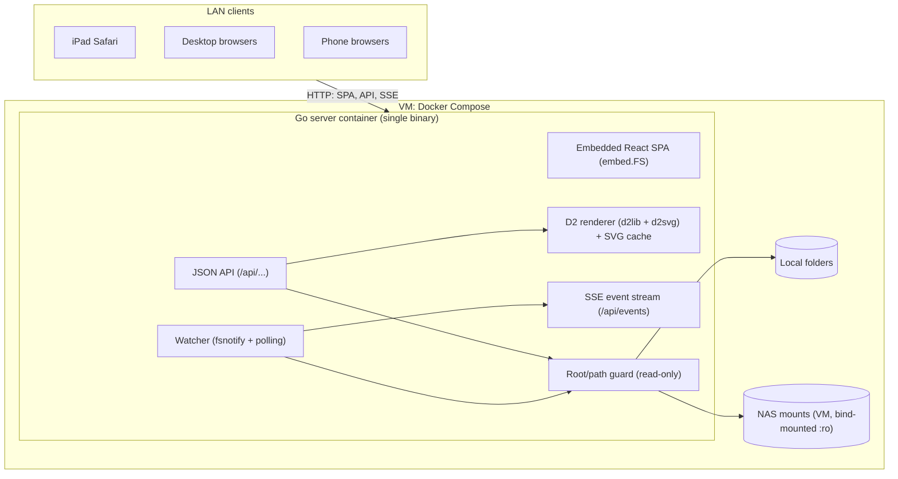
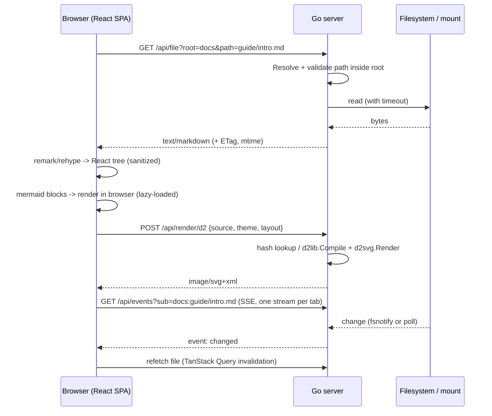

# Project Architecture

## Purpose

High-level architecture for the LAN Markdown viewer. Detailed API contracts and module layout are finalized in the planning phase ([Implementation Plan](./Implementation.md)). This document reflects the Go backend chosen in [Tech Stack](./Tech-Stack.md).

## System Diagram



## Request Flow: Viewing A Markdown File



## Components

| Component | Responsibility |
| --- | --- |
| Config | Loads roots (name → absolute path), listen address, poll interval, size limits, and per-root mount hints (watch vs. poll) from environment variables only. |
| Root/path guard | Built on Go `os.Root` (`OpenRoot`, then `Open`/`Stat`/`Lstat`/`ReadDir` via the root). `Resolve(rel)` lexical prechecks produce the 400 cases (raw `..` anywhere, absolute, backslash, NUL/control/bidi characters, too long). Symlink escapes are detected from `os.Root`'s own error (403, fail-closed to 500 if Go changes it). Special files (FIFO, device, socket) are refused with 403 via `O_NONBLOCK` + fstat. Permission denied is 403; ELOOP and ENOTDIR are 404. Errors carry `PublicMessage()`, the only text safe for clients. Every file access goes through this. Per-root in-flight fs-op cap; a root that times out is marked `unavailable` and probed with one stat at a time. |
| Listing API | Directory entries with type, size, mtime. No pagination in MVP: capped at `MDV_MAX_LIST_ENTRIES` with a `truncated` flag. Applies timeouts. |
| File API | Serves raw bytes by allowlist (raster images and text kinds only), with ETag/Last-Modified and range support for media. Everything else, including SVG/HTML, is an attachment or sandboxed. |
| D2 renderer | Compiles D2 source to SVG with dagre/ELK, with an empty `fs.FS` (no imports). Bounded concurrency (slot held until the render goroutine returns) and timeout per render. LRU cache keyed by hash, including compile errors and timeouts. |
| Watcher + SSE | One stream per tab carrying many subscriptions. Uses fsnotify on local disks and mtime polling on network mounts. Sends coalesced change events. |
| SPA: Shell | Layout, theme, responsive sidebar drawer, routing (`/view/:root/*`). |
| SPA: Browser | Root list, folder listing, breadcrumbs, filter, workspace tree. |
| SPA: Document view | Markdown pipeline, link/image rewriting, TOC, Mermaid and D2 diagram components, error boundaries. |

## Repository Layout

Go module: `github.com/awesomejt/markdown-viewer`. Binary: `mdv`.

```text
cmd/mdv/main.go            # entrypoint: load config, build server, graceful shutdown
internal/config/           # env config parsing, validation
internal/fsroot/           # Root registry, path guard, listing, file reads with timeouts
internal/d2render/         # D2 compile/render, LRU cache, concurrency limit
internal/watch/            # fsnotify + mtime poller, subscription hub
internal/api/              # HTTP handlers, error model, middleware (slog, recover)
internal/web/              # embed.FS of web/dist + SPA fallback handler
web/                       # Vite + React + TypeScript SPA
  src/api/                 # typed API client + TanStack Query hooks
  src/app/                 # shell, routes, theme, layout
  src/browse/              # roots, listings, breadcrumbs, workspace tree
  src/markdown/            # remark/rehype pipeline, link rewriting, components
  src/diagrams/            # Mermaid + D2 components
  src/live/                # EventSource subscription
e2e/                       # Playwright tests + fixture tree (testdata/)
testdata/fixtures/         # shared Markdown/diagram/symlink fixtures
Dockerfile, compose.yaml, .dockerignore
Makefile                   # build, test, lint, check, docker, e2e
```

## Configuration

Environment variables only, set in `compose.yaml`. A config file is deferred (D-20).

| Variable | Default | Meaning |
| --- | --- | --- |
| `MDV_LISTEN` | `:8080` | Listen address. |
| `MDV_ROOTS` | *(required)* | Comma-separated `name=/abs/path[:watch]` entries. `watch` is `poll` (default) or `fsnotify`. Example: `markdown=/data/markdown,notes=/data/notes:fsnotify`. Names match `^[a-z0-9][a-z0-9_-]{0,31}$`. |
| `MDV_POLL_INTERVAL` | `3s` | mtime polling interval for `poll` roots. |
| `MDV_FS_TIMEOUT` | `5s` | Timeout for any single filesystem operation (dead mounts). |
| `MDV_FS_MAX_INFLIGHT` | `4` | Per-root cap on concurrent filesystem operations. When full, requests fail immediately with 504 `fs_timeout`. |
| `MDV_MAX_LIST_ENTRIES` | `20000` | Maximum entries returned by `/api/list`; beyond it the response sets `"truncated": true`. |
| `MDV_MAX_FILE_BYTES` | `5242880` | Maximum size served by `/api/file` without `?force=1` (applies to text kinds only; media streams). |
| `MDV_D2_TIMEOUT` | `10s` | Per-render timeout. |
| `MDV_D2_CONCURRENCY` | `2` | Concurrent D2 renders. |
| `MDV_D2_CACHE_ENTRIES` | `256` | LRU cache size for rendered SVG. |
| `MDV_LOG_LEVEL` | `info` | `debug`, `info`, `warn`, `error`. |

Startup fails fast if a root is missing, is not a directory, or a name is duplicated.

## HTTP API Contract

All `/api` responses except raw file bodies, SVG, and SSE are JSON. `path` is always relative to the root, uses `/` separators, and `""` means the root itself. The server never returns host paths.

**Error model:** non-2xx JSON responses use `{"error": {"code": "<code>", "message": "<human text>"}}`.

| HTTP | `code` | When |
| --- | --- | --- |
| 400 | `bad_request` | Missing or invalid parameters, malformed path, or more than 32 `sub` values on `/api/events`. |
| 403 | `forbidden` | Path escapes the root (traversal or symlink). |
| 404 | `not_found` | Unknown root or path. |
| 413 | `too_large` | Text file over `MDV_MAX_FILE_BYTES` without `force=1`, or D2 source over 256 KiB (enforced with `http.MaxBytesReader` before JSON decode). |
| 422 | `render_error` | D2 compile failure (including attempted imports). The message includes the D2 error text, which contains line/column. |
| 503 | `busy` | No D2 render slot became free within 1 s. |
| 504 | `fs_timeout` | Filesystem operation exceeded `MDV_FS_TIMEOUT`, or the root's in-flight cap (`MDV_FS_MAX_INFLIGHT`) is full or the root is `unavailable`. |
| 504 | `render_timeout` | D2 render exceeded `MDV_D2_TIMEOUT`. |
| 500 | `internal` | Anything else. Details are logged, not returned. |

### Endpoints

| Method & path | Response |
| --- | --- |
| `GET /healthz` | `200 {"status":"ok"}`. Never touches roots, so a dead mount cannot fail the healthcheck. |
| `GET /api/roots` | `{"roots":[{"name":"markdown","watch":"poll","available":true}]}`. `available` is false after a filesystem timeout until a probe stat succeeds. |
| `GET /api/list?root=&path=` | `{"root","path","truncated":false,"entries":[{"name","type":"dir\|file","kind","size","mtime"}]}`. `kind` is one of `markdown` (`.md`, `.markdown`, `.mdx`), `diagram` (`.mmd`, `.mermaid`, `.d2`), `image` (`png jpg jpeg gif webp svg avif`), `text` (known text/code extensions), `other`. `mtime` is RFC 3339. Dot-files are included, and the client filters them. Symlinks are resolved and reported as their target type, and omitted if they escape the root. Sorted dirs first, then by name (case-insensitive). No pagination: at most `MDV_MAX_LIST_ENTRIES` entries are returned and `truncated` is true when more exist. |
| `GET /api/file?root=&path=[&force=1]` | Raw bytes via `http.ServeContent` (Range, `If-None-Match`, `Last-Modified`). `ETag` is `mtimeNs-size-ino`, and the response sends `Cache-Control: no-cache`. Allowlist serving (see below). Every response sets `X-Content-Type-Options: nosniff` and `Content-Security-Policy: sandbox; default-src 'none'; style-src 'unsafe-inline'; img-src data:`. |
| `POST /api/render/d2` | Request `{"source": "...", "theme": "light\|dark", "layout": "dagre\|elk"}`. `layout` defaults to `dagre` (only `dagre` is required in MVP). Response is `image/svg+xml`. The cache key is sha256(source+theme+layout). Compile errors and timeouts are cached too (negative cache). The POST response sets no `Cache-Control`. Body is limited to 256 KiB with `http.MaxBytesReader` before JSON decode. See D2 Safety. |
| `GET /api/events?sub=<root>:<path>` | SSE stream, one per browser tab. `sub` is repeatable (max 32 per stream, else 400). Each `path` may be a file or a directory; a directory watch covers its direct children. Events: `event: change` with `data: {"root":"<root>","path":"<rel>","op":"modified\|created\|deleted"}`. A `: ping` comment is sent every 25 s. Events are coalesced per `(root, path)` within 250 ms. The client reopens the stream when its subscription set changes. |
| `GET /*` | Embedded SPA assets. Misses under `/assets/` and `/api/` return 404, never `index.html`. Other unknown paths return `index.html` (history routing). `index.html` is sent with `Cache-Control: no-cache`; hashed assets with `public, max-age=31536000, immutable`. |

### File Serving (Allowlist)

| Class | Extensions | Served as |
| --- | --- | --- |
| Raster images | `png jpg jpeg gif webp avif` | Their image MIME type. |
| Text kinds | Markdown, diagram, and known text/code extensions | `text/plain; charset=utf-8`. |
| SVG | `svg` | `image/svg+xml` only together with the sandbox CSP above, for `` use. Otherwise an attachment. |
| Everything else | `html htm xhtml xml xsl shtml`, unknown | `application/octet-stream` with `Content-Disposition: attachment`. |

### D2 Safety

- Compile with an explicit empty `fs.FS` so D2 file imports cannot read the host. Tests assert that `@../../etc/passwd` and other imports fail. Confirm how D2 v0.9.0 exposes the FS in `CompileOptions` during B5.
- The concurrency slot is held until the render goroutine actually returns, because dagre ignores `ctx`. A request waits at most 1 s for a slot, else `503 busy`. A render timeout returns `504 render_timeout`.

### Watch Semantics

- The hub reference-counts subscriptions per `(root, path)` and stops watching when the last subscriber disconnects.
- `poll` roots: every `MDV_POLL_INTERVAL`, directories poll one `ReadDir` name set plus the directory's own mtime (no per-child stat). Files poll stat size + mtime (ns) + inode. All stats go through `MDV_FS_TIMEOUT` and the per-root in-flight cap. The poller skips a path whose previous stat is still pending.
- NAS attribute caching (CIFS `actimeo`, NFS `acdirmax`) can delay change visibility. DOC1 documents this and recommends low values for live reload.
- SSE robustness: each stream uses `http.ResponseController` to clear the write deadline and flushes after every event. On `visibilitychange` to visible and on each EventSource `open`, the client invalidates its active queries (iPad backgrounding drops streams).
- `fsnotify` roots: an inotify watch on the path, or on the parent directory for files, to catch editors that write via rename.

## Frontend Routes

| Route | View |
| --- | --- |
| `/` | Root list. |
| `/browse/:root/*` | Folder listing for the path. |
| `/view/:root/*` | File view chosen by kind: Markdown document, diagram page, image, text, or download. |
| `?ws=<rel-folder>` (on browse/view) | Workspace mode: sidebar tree anchored at that folder, kept while navigating within it. |
| `#<slug>` | Heading anchor within a document. |

**Link rewriting in Markdown:**

- A relative `.md`/diagram link becomes `/view/:root/<resolved>` with `ws` preserved, or dropped when the target is outside the workspace folder.
- A relative directory link becomes `/browse/...`.
- A relative image or other asset becomes `/api/file?root=&path=<resolved>`.
- Absolute `http(s)`/`mailto` links are left unchanged and open in a new tab.
- Links that resolve outside the root are rendered as plain text with a warning title.

**Path encoding:** the client encodes each path segment with `encodeURIComponent`. On not-found, the server retries the NFC/NFD alternate form of the requested path (Mac SMB writes NFD names).

**Markdown pipeline order (exact):** remark-gfm, remark-frontmatter, rehype-raw, rehype-sanitize (schema allows a `language-*` class on `code`), rehype-slug, then Shiki. Mermaid and D2 blocks are detected in the `code` component after sanitizing. Raw-HTML `id` values stay `user-content-` prefixed, while `[x](#heading)` links resolve to slugs.

**Client resilience:** the SPA handles `vite:preloadError` by reloading once.

## Security Model

- Trusted LAN, no authentication (owner decision). Read-only. Host paths are never shown to clients, only `root` names and relative paths.
- Markdown HTML is sanitized. Diagram SVG is sanitized or isolated. User-supplied HTML files never run in the app origin.
- Container hardening (D1): `read_only: true`, `cap_drop: [ALL]`, `no-new-privileges`, and a `user:` matching the NAS mount's `uid=`/`gid=`.
- Binds to a configured address. The README warns against port-forwarding it or exposing it publicly.
- `os.Root` crosses mount points and hard links, so bind-mounting something under a root exposes it.
