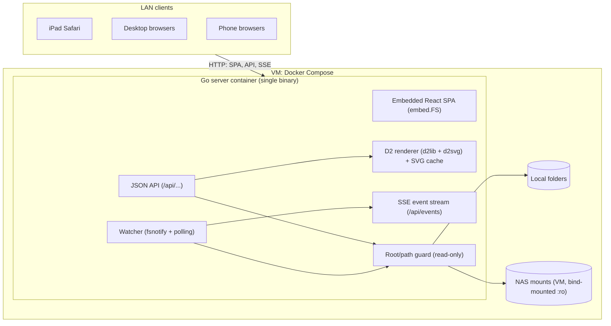
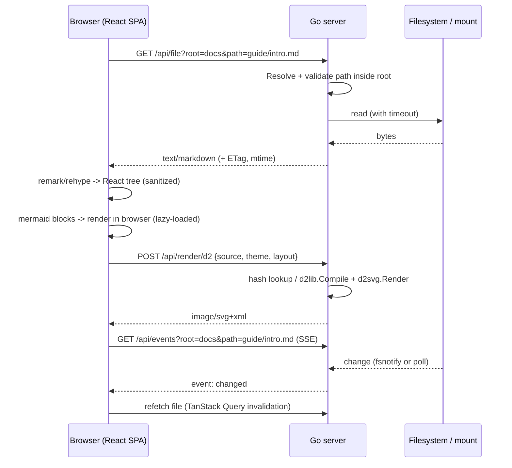

# Project Architecture

## Purpose

High-level architecture for the LAN Markdown viewer. Detailed API contracts and module layout are finalized in the planning phase ([Implementation Plan](./Implementation.md)). This document reflects the Go backend chosen in [Tech Stack](./Tech-Stack.md).

## System Diagram

## Request Flow: Viewing A Markdown File

## Components

| Component | Responsibility |
| --- | --- |
| Config | Loads roots (name → absolute path), listen address, poll interval, size limits, and per-root mount hints (watch vs. poll). |
| Root/path guard | Turns `(root, relative path)` into a real path. Rejects `..`, absolute paths, and symlinks that resolve outside the root. Every file access goes through this. |
| Listing API | Directory entries with type, size, mtime. Paginated or streamed for large folders. Applies timeouts. |
| File API | Serves raw bytes with a content type, ETag/Last-Modified, and range support for media. Serves HTML/SVG files with a restrictive CSP or as attachments. |
| D2 renderer | Compiles D2 source to SVG with dagre/ELK. Bounded concurrency and timeout per render. LRU cache keyed by hash. |
| Watcher + SSE | Subscribes each client to the paths it is viewing. Uses fsnotify on local disks and mtime polling on network mounts. Sends coalesced change events. |
| SPA: Shell | Layout, theme, responsive sidebar drawer, routing (`/view/:root/*`). |
| SPA: Browser | Root list, folder listing, breadcrumbs, filter, workspace tree. |
| SPA: Document view | Markdown pipeline, link/image rewriting, TOC, Mermaid and D2 diagram components, error boundaries. |

## Proposed HTTP API (draft)

| Method & path | Purpose |
| --- | --- |
| `GET /api/roots` | List configured roots (names only, never host paths). |
| `GET /api/list?root=&path=` | Directory listing. |
| `GET /api/file?root=&path=` | Raw file contents. |
| `POST /api/render/d2` | Render D2 source to SVG. |
| `GET /api/events?root=&path=` | SSE stream of change events for a file or folder. |
| `GET /healthz` | Health check. |
| `GET /*` | SPA assets with fallback to `index.html`. |

## Security Model

- Trusted LAN, no authentication (owner decision). Read-only. Host paths are never shown to clients, only `root` names and relative paths.
- Markdown HTML is sanitized. Diagram SVG is sanitized or isolated. User-supplied HTML files never run in the app origin.
- Binds to a configured address. The README warns against port-forwarding it or exposing it publicly.
