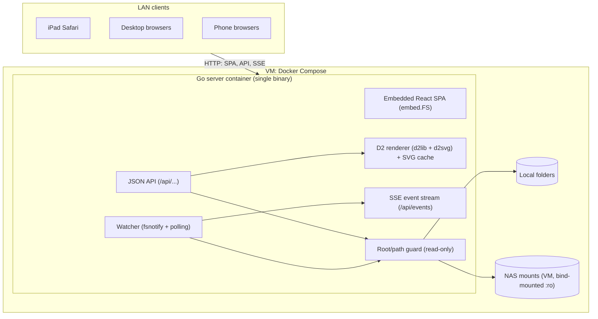
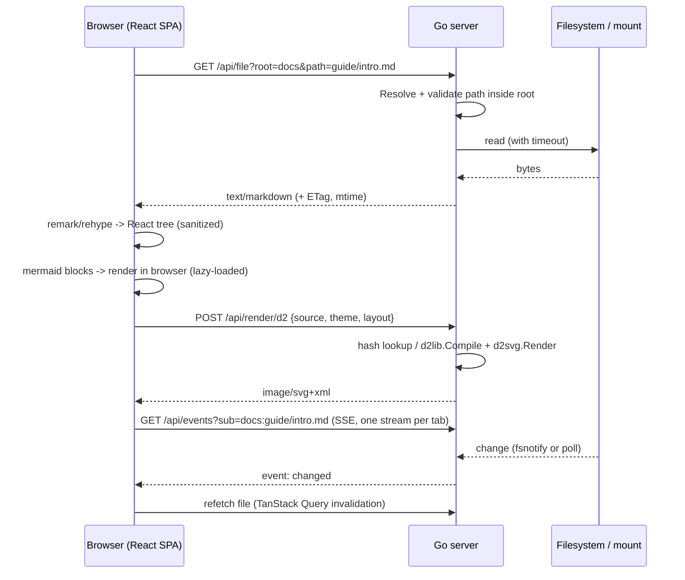

# Project Architecture

## Purpose

High-level architecture for the LAN Markdown viewer. Detailed API contracts and module layout are finalized in the planning phase ([Implementation Plan](./Implementation.md)). This document reflects the Go backend chosen in [Tech Stack](./Tech-Stack.md).

## System Diagram



## Request Flow: Viewing A Markdown File



## Components

| Component          | Responsibility                                                                                                                                                                                                                                                                                                                                                                                                                                                                                                                                                                                                                                                                                                                                                                                                                                                                                                                                                                                                                                                                                                                                                                                           |
| ------------------ | -------------------------------------------------------------------------------------------------------------------------------------------------------------------------------------------------------------------------------------------------------------------------------------------------------------------------------------------------------------------------------------------------------------------------------------------------------------------------------------------------------------------------------------------------------------------------------------------------------------------------------------------------------------------------------------------------------------------------------------------------------------------------------------------------------------------------------------------------------------------------------------------------------------------------------------------------------------------------------------------------------------------------------------------------------------------------------------------------------------------------------------------------------------------------------------------------------- |
| Config             | Loads roots (name → absolute path), listen address, poll interval, size limits, and per-root mount hints (watch vs. poll) from environment variables only.                                                                                                                                                                                                                                                                                                                                                                                                                                                                                                                                                                                                                                                                                                                                                                                                                                                                                                                                                                                                                                               |
| Root/path guard    | Built on Go `os.Root` (`OpenRoot`, then `Open`/`Stat`/`Lstat`/`ReadDir` via the root). `Resolve(rel)` lexical prechecks produce the 400 cases (raw `..` anywhere, absolute, backslash, NUL/control/bidi characters, too long). Symlink escapes are detected from `os.Root`'s own error (403, fail-closed to 500 if Go changes it). Special files (FIFO, device, socket) are refused with 403 via `O_NONBLOCK` + fstat. Permission denied is 403; ELOOP and ENOTDIR are 404. Errors carry `PublicMessage()`, the only text safe for clients. Every file access goes through this. Per-root in-flight fs-op cap: callers wait for a slot up to `MDV_FS_TIMEOUT`, and a wait that expires is `fs_timeout` but does not mark the root unavailable; a root that times out is marked `unavailable` and probed with one stat at a time. Caller cancellation is reported as `fs_timeout` but does not mark the root unavailable. Listing a non-directory is 400. A not-found path is retried once in its alternate NFC/NFD form. File bodies are read through `Handle.Reader`, which runs each `ReadAt` under the same timeout and in-flight slot, so a mount that dies after `Open` cannot hang `ServeContent`. |
| Listing API        | Directory entries with type, size, mtime. No pagination in MVP: capped at `MDV_MAX_LIST_ENTRIES` with a `truncated` flag. Applies timeouts.                                                                                                                                                                                                                                                                                                                                                                                                                                                                                                                                                                                                                                                                                                                                                                                                                                                                                                                                                                                                                                                              |
| File API           | Serves raw bytes by allowlist (raster images and text kinds only), with ETag/Last-Modified and range support for media. Everything else, including SVG/HTML, is an attachment or sandboxed.                                                                                                                                                                                                                                                                                                                                                                                                                                                                                                                                                                                                                                                                                                                                                                                                                                                                                                                                                                                                              |
| D2 renderer        | Compiles D2 source to SVG with dagre/ELK, with an empty `fs.FS` (no imports). Bounded concurrency (slot held until the render goroutine returns) and timeout per render. LRU cache keyed by hash (including compile errors and timeouts), bounded by entry count (`MDV_D2_CACHE_ENTRIES`) and 64 MiB total; SVGs over 4 MiB are not cached.                                                                                                                                                                                                                                                                                                                                                                                                                                                                                                                                                                                                                                                                                                                                                                                                                                                              |
| Watcher + SSE      | One stream per tab carrying many subscriptions. Uses fsnotify on local disks and mtime polling on network mounts. Sends coalesced change events.                                                                                                                                                                                                                                                                                                                                                                                                                                                                                                                                                                                                                                                                                                                                                                                                                                                                                                                                                                                                                                                         |
| SPA: Shell         | Layout, theme, responsive sidebar drawer, routing (`/view/:root/*`).                                                                                                                                                                                                                                                                                                                                                                                                                                                                                                                                                                                                                                                                                                                                                                                                                                                                                                                                                                                                                                                                                                                                     |
| SPA: Browser       | Root list, folder listing, breadcrumbs, filter, workspace tree.                                                                                                                                                                                                                                                                                                                                                                                                                                                                                                                                                                                                                                                                                                                                                                                                                                                                                                                                                                                                                                                                                                                                          |
| SPA: Document view | Markdown pipeline, link/image rewriting, TOC, Mermaid and D2 diagram components, error boundaries.                                                                                                                                                                                                                                                                                                                                                                                                                                                                                                                                                                                                                                                                                                                                                                                                                                                                                                                                                                                                                                                                                                       |

## Repository Layout

Go module: `github.com/awesomejt/markdown-viewer`. Binary: `mdv`.

```text
cmd/mdv/main.go            # entrypoint: load config, build server, graceful shutdown
internal/config/           # env config parsing, validation
internal/fsroot/           # Root registry, path guard, listing, file reads with timeouts
internal/d2render/         # D2 compile/render, LRU cache, concurrency limit
internal/watch/            # fsnotify + mtime poller, subscription hub
internal/api/              # HTTP handlers, error model, middleware (slog, recover)
internal/web/              # embed.FS of web/dist + SPA fallback handler
web/                       # Vite + React + TypeScript SPA
  src/api/                 # typed API client + TanStack Query hooks
  src/app/                 # shell, routes, theme, layout
  src/browse/              # roots, listings, breadcrumbs, workspace tree
  src/markdown/            # remark/rehype pipeline, link rewriting, components
  src/diagrams/            # Mermaid + D2 components
  src/live/                # EventSource subscription
e2e/                       # Playwright tests + fixture tree (testdata/)
testdata/fixtures/         # shared Markdown/diagram/symlink fixtures
Dockerfile, compose.yaml, .dockerignore
Makefile                   # build, test, lint, check, docker, e2e
```

## Configuration

Environment variables only, set in `compose.yaml`. A config file is deferred (D-20).

| Variable | Default | Meaning |
| --- | --- | --- |
| `MDV_LISTEN` | `:8080` | Listen address. |
| `MDV_ROOTS` | _(required)_ | Comma-separated `name=/abs/path[:watch]` entries. `watch` is `poll` (default) or `fsnotify`. Example: `markdown=/data/markdown,notes=/data/notes:fsnotify`. Names match `^[a-z0-9][a-z0-9_-]{0,31}$`. |
| `MDV_POLL_INTERVAL` | `2s` | mtime polling interval for `poll` roots. |
| `MDV_FS_TIMEOUT` | `5s` | Timeout for any single filesystem operation (dead mounts). |
| `MDV_FS_MAX_INFLIGHT` | `4` | Per-root cap on concurrent filesystem operations. Callers wait for a slot up to `MDV_FS_TIMEOUT`; a wait that expires is 504 `fs_timeout` but does not mark the root unavailable. |
| `MDV_MAX_LIST_ENTRIES` | `20000` | Maximum entries returned by `/api/list`; beyond it the response sets `"truncated": true`. |
| `MDV_MAX_FILE_BYTES` | `5242880` | Maximum size served by `/api/file` without `?force=1` (applies to text kinds only; media streams). |
| `MDV_D2_TIMEOUT` | `10s` | Per-render timeout. |
| `MDV_D2_CONCURRENCY` | `2` | Concurrent D2 renders. |
| `MDV_D2_CACHE_ENTRIES` | `256` | LRU cache size for rendered SVG. |
| `MDV_LOG_LEVEL` | `info` | `debug`, `info`, `warn`, `error`. |
| `MDV_ALLOWED_HOSTS` | _(none)_ | Comma-separated extra `Host` hostnames to accept (DNS rebinding guard). IP literals and `localhost` are always allowed and the port is ignored. Non-ASCII names must be given in punycode (`xn--`) form. Other hosts get 421 `host_not_allowed`. `*` alone disables the check (reverse proxies; logs a warning). |
| `MDV_PREFS` | _(none)_ | Optional absolute path to a global preferences YAML file (top-level `settings:`), bind-mounted read-only. Unset means none; a missing file means defaults. Re-read on every request (see Projects And Settings). |

Startup fails fast on a syntax error (bad or duplicate name, relative path) or a root path that exists but is not a directory. A root that is missing, errors, or does not answer within `MDV_FS_TIMEOUT` at boot (for example a NAS that is not up yet) does not stop startup: roots are opened lazily and checked concurrently, the root starts `available:false`, a warning is logged, and the usual recovery probe opens it once it answers, with no restart. If a mount point directory exists but the share is not yet mounted, the open succeeds on the empty directory. While the root is in use, at most once every 2 s a call compares the device and inode of the configured path (`stat`) with the open directory and reopens the root when they differ, so a later mount or unmount is picked up without a restart. The replaced `os.Root` is retired, not closed, because calls may still use it; each retired root is closed by its own timer after twice `MDV_FS_TIMEOUT` (at least 1 s) or at shutdown, so a lazily unmounted share is released (FIX-16, FIX-27). Symlinks in the root's parent folders are resolved once (`EvalSymlinks` of the parent) at the first open attempt that finds them; the last component stays literal, so the root itself must be a real directory, and every open uses that pinned path. After each open, the pinned path is walked from `/` with `openat(O_NOFOLLOW|O_DIRECTORY)` per component and must reach the opened root's device and inode; otherwise the new root is closed and the root stays unavailable (`root path is a symlink or was replaced`). A root replaced by a symlink is therefore never followed, also after a restart; a parent folder replaced by a symlink is refused while mdv runs, but one planted before startup is resolved into the pin (parents must not be writable by untrusted users). `O_PATH` needs only search permission on the parents; a walk failing with another error (`EACCES`, `EIO`) is reported as itself. The fsnotify watcher's host paths use the pinned path (FIX-21).

Commands: `mdv` or `mdv serve` runs the server (graceful shutdown on SIGINT/SIGTERM, 10 s drain); `mdv version` prints the version; `mdv healthcheck` GETs `/healthz` on loopback at the `MDV_LISTEN` port (3 s timeout, exit 0 only on 200 `{"status":"ok"}`, else 1) and does not read `MDV_ROOTS`.

## HTTP API Contract

All `/api` responses except raw file bodies, SVG, and SSE are JSON. `path` is always relative to the root, uses `/` separators, and `""` means the root itself. The server never returns host paths.

**Error model:** non-2xx JSON responses use `{"error": {"code": "<code>", "message": "<human text>"}}`.

| HTTP | `code` | When |
| --- | --- | --- |
| 400 | `bad_request` | Missing or invalid parameters, malformed path, or on `/api/events` a total of 0 or more than 32 `sub` plus `lsub` values, or a malformed `sub`. |
| 403 | `forbidden` | Path escapes the root (traversal or symlink). |
| 404 | `not_found` | Unknown root or path. |
| 413 | `too_large` | Text file over `MDV_MAX_FILE_BYTES` without `force=1`, or D2 source over 256 KiB (enforced with `http.MaxBytesReader` before JSON decode). |
| 415 | `unsupported_media_type` | `POST /api/render/d2` without `Content-Type: application/json`. |
| 421 | `host_not_allowed` | `Host` header is not an IP literal, `localhost`, or in `MDV_ALLOWED_HOSTS`. |
| 422 | `render_error` | D2 compile failure (including attempted imports). The message includes the D2 error text, which contains line/column. |
| 422 | `project_invalid` | `GET /api/project`: the project file is over 32 KiB, has a YAML syntax error, an unsupported version, or a forbidden construct (alias, anchor, tag, merge key, too deep or complex, several documents). `error.line` (optional) is the 1-based line. |
| 503 | `busy` | No D2 render slot became free within 1 s. |
| 504 | `fs_timeout` | Filesystem operation exceeded `MDV_FS_TIMEOUT`, or no in-flight slot (`MDV_FS_MAX_INFLIGHT`) freed within that time (this wait does not mark the root unavailable), or the root is `unavailable` (fails immediately). |
| 504 | `render_timeout` | D2 render exceeded `MDV_D2_TIMEOUT`. |
| 500 | `internal` | Anything else. Details are logged, not returned. |

### Endpoints

| Method & path | Response |
| --- | --- |
| `GET /healthz` | `200 {"status":"ok"}`. Never touches roots, so a dead mount cannot fail the healthcheck. |
| `GET /api/roots` | `{"roots":[{"name":"markdown","watch":"poll","available":true}]}`. `available` is false after a filesystem timeout, or when the root could not be opened at startup, until a probe stat succeeds. |
| `GET /api/list?root=&path=` | `{"root","path","truncated":false,"entries":[{"name","type":"dir\|file","kind","size","mtime"}]}`. `kind` is one of `markdown` (`.md`, `.markdown`, `.mdx`), `diagram` (`.mmd`, `.mermaid`, `.d2`), `image` (`png jpg jpeg gif webp svg avif`), `text` (known text/code extensions), `project` (`*.mdv.yaml`, `*.mdv.yml`, checked before the extension map), `other`. `mtime` is RFC 3339. Dot-files are included, and the client filters them. Symlinks are resolved and reported as their target type, and omitted if they escape the root. Sorted dirs first, then by name (case-insensitive). No pagination: at most `MDV_MAX_LIST_ENTRIES` entries are returned and `truncated` is true when more exist. |
| `GET /api/prefs` | `{"configured","settings","warnings","error"}`; always 200, empty settings when unset, missing or invalid. `Cache-Control: no-cache`. See Projects And Settings. |
| `GET /api/project?root=&path=` | `{"root","path","name","open","entries","settings","warnings"}` for a `*.mdv.yaml`/`*.mdv.yml` file; references resolved through `fsroot`. 422 `project_invalid` on fatal errors. `Cache-Control: no-cache`. See Projects And Settings. |
| `GET /api/file?root=&path=[&force=1]` | Raw bytes via `http.ServeContent` (Range, `If-None-Match`, `Last-Modified`). Each body chunk (≤ 32 KiB) gets a fresh 10 s write deadline, so a client that stops reading releases the handler and file descriptor. `ETag` is `mtimeNs-size-ino`, and the response sends `Cache-Control: no-cache`. Allowlist serving (see below). Every response sets `X-Content-Type-Options: nosniff` and `Content-Security-Policy: sandbox; default-src 'none'; style-src 'unsafe-inline'; img-src data:`. |
| `POST /api/render/d2` | Request `{"source": "...", "theme": "light\|dark", "layout": "dagre\|elk"}`. An empty or missing `layout` uses the source's `vars.d2-config.layout-engine` (`elk`; anything else is dagre); an explicit value overrides it. Request must be `Content-Type: application/json` (else 415 `unsupported_media_type`); cross-origin requests get 403 (`http.CrossOriginProtection`). Response is `image/svg+xml`; every response carries the `fileCSP` sandbox CSP and `nosniff`. The cache key is sha256 over the D2 version, layout, theme and source (see D2 Safety). Compile errors and timeouts are cached too (negative cache). The POST response sets no `Cache-Control`. Body is limited to 256 KiB with `http.MaxBytesReader` before JSON decode. See D2 Safety. |
| `GET /api/events?sub=<root>:<path>` | SSE stream, one per browser tab. `sub` is repeatable; `lsub` is the same `<root>:<path>` form for best-effort low-priority subs (Markdown images, tree folders). Together they max out at 32 per stream, else 400. A `sub` that fails validation fails the whole stream (400/403/404) as before. An `lsub` that is malformed or fails validation (bad path, escape, missing parent on an fsnotify root, unknown root, timeout) is silently dropped, and so are all `lsub` values if registering them would exceed the watch caps; a stream with every `lsub` dropped and no `sub` still opens and only pings. Each `path` may be a file, a directory, or not exist yet; a directory watch covers its direct children. Events: `event: change` with `data: {"root":"<root>","path":"<rel>","op":"modified\|created\|deleted"}`. Only GET opens a stream; HEAD and other methods get `405` with `Allow: GET`. The stream starts with a `: open` comment (so every browser fires `open` at once) and a `: ping` comment is sent every 25 s. Events are coalesced per `(root, path)` within 250 ms. The client reopens the stream when its subscription set changes. |
| `GET /*` | Embedded SPA assets. Misses under `/assets/` and `/api/` return 404, never `index.html`. Other unknown paths return `index.html` (history routing). `index.html` is sent with `Cache-Control: no-cache`; hashed assets with `public, max-age=31536000, immutable`. Other static files (favicon, icons, `manifest.webmanifest`) are `no-cache`; `.webmanifest` is served as `application/manifest+json` (missing from Go's MIME table). Only GET and HEAD are allowed (else 405). Directories are never listed. If the bundle has no `index.html` (not built), non-asset paths return a plain-text `503 web UI not built`. |

### File Serving (Allowlist)

| Class           | Extensions                                        | Served as                                                                                           |
| --------------- | ------------------------------------------------- | --------------------------------------------------------------------------------------------------- |
| Raster images   | `png jpg jpeg gif webp avif`                      | Their image MIME type.                                                                              |
| Text kinds      | Markdown, diagram, and known text/code extensions | `text/plain; charset=utf-8`.                                                                        |
| SVG             | `svg`                                             | `image/svg+xml` only together with the sandbox CSP above, for `` use. Otherwise an attachment. |
| Everything else | `html htm xhtml xml xsl shtml`, unknown           | `application/octet-stream` with `Content-Disposition: attachment`.                                  |

### D2 Safety

- Compile with an explicit empty `fs.FS` so D2 file imports cannot read the host. **Verified in D2 v0.9.0:** `d2lib.CompileOptions.FS` is passed through `d2compiler` to `d2ir`, which calls `os.Open` on the import path when `FS` is nil and `FS.Open` otherwise. A nil FS would therefore read the host, so `internal/d2render` always sets a custom empty `fs.FS` (every `Open` returns `ErrNotExist`). Tests assert that `@../../etc/passwd`, `...@x`, `@/etc/passwd`, `@x.d2` and imports inside maps all fail with a compile error (422).
- Themes: `light` (default when empty) is Neutral Default, ID 0; `dark` is Dark Mauve, ID 200. Layouts: `dagre` and `elk`; empty means the source's `d2-config` `layout-engine` when it is `elk`, else dagre (the layout resolver maps any other engine name, such as `tala`, to dagre). Any other requested value is 400 `bad_request`. Themes from `d2-config` are ignored, as the app theme always sets the theme ID.
- The concurrency slot is held until the render goroutine actually returns, because dagre ignores `ctx`. A request waits at most 1 s for a slot, else `503 busy`. A render timeout (wall clock, also passed to Compile as a context deadline) returns `504 render_timeout`.
- Each slot owns its own `textmeasure.Ruler` (created lazily), because Ruler concurrency safety is unverified. A Ruler is never shared between concurrent renders.
- Cache key: sha256 over length-prefixed (D2 version constant, requested layout with empty kept distinct, theme ID, source). Successes, compile errors and timeouts are cached; busy, bad-request, caller-cancelled and internal errors are not. Identical concurrent requests share one render (hand-rolled singleflight), and the render runs detached from any single caller's context, so a cancelled client cannot poison the cache. The cache is bounded by entry count (`MDV_D2_CACHE_ENTRIES`) and 64 MiB total; SVGs over 4 MiB are not cached (still returned to the caller).

### Watch Semantics

- The hub reference-counts subscriptions per `(root, path)` and stops watching when the last subscriber disconnects.
- `poll` roots: every `MDV_POLL_INTERVAL`, directories poll one `ReadDir` name set plus the directory's own mtime (no per-child stat). Files poll stat size + mtime (ns) + inode. All stats go through `MDV_FS_TIMEOUT` and the per-root in-flight cap. The poller skips a path whose previous stat is still pending.
- NAS attribute caching (CIFS `actimeo`, NFS `acdirmax`) can delay change visibility. DOC1 documents this and recommends low values for live reload.
- SSE robustness: each stream uses `http.ResponseController` to replace the server write deadline with a fresh 10 s deadline before every event batch and every ping (a write error or missed deadline ends the stream, so a client that stops reading cannot hold the handler forever), and flushes after every event. On `visibilitychange` to visible and on each EventSource `open`, the client invalidates its active queries (iPad backgrounding drops streams).
- Live client (`src/live/`): `LiveProvider` (inside the `QueryClientProvider`) owns the tab's single EventSource through a `LiveController`. Views call `useLiveSubscription(root, path)` (file views subscribe to their file, folder views to their folder; each root-relative image in a Markdown document subscribes to its image file with low priority, and each folder shown in the workspace tree, i.e. the workspace folder and every expanded folder, subscribes to itself with low priority so child adds, removes and renames refresh it, FR-5.2). The controller ref-counts and de-duplicates `root:path` keys, sorts and caps them at 32 (low-priority keys only fill the slots the others leave, so a document with many images or a deeply expanded tree keeps its own subscription), debounces changes (50 ms) so navigation does not churn connections, and keeps no stream while the set is empty. A CLOSED stream (non-200, e.g. 503) is reopened with capped exponential backoff (1 s to 30 s, jittered, reset on `open`); CONNECTING errors are left to the browser. On `change` it invalidates the file query, the parent listing (the `/view` kind depends on it) and the path's own listing; on `open` and on visible it invalidates active `roots`/`list`/`file` queries only. A deleted file's refetch 404s into the normal error state and recovers on `created`. Markdown re-renders keep the heading nearest the viewport top at the same offset (snapshot in render, restore in a layout effect), falling back to the previous scrollTop; refetches keep the previous data, so there is no loading flash.
- `fsnotify` roots: an inotify watch on the path, or on the parent directory for files, to catch editors that write via rename.
- Directory event scheme (both modes): a child appearing or disappearing is `created` or `deleted` on the child's path, and the directory itself gets `modified` (its mtime changed). A change to a child's content does not touch the directory's mtime, so it is seen only by subscribing to the child. The directory itself vanishing or reappearing is `deleted` or `created` on its own path. A file replaced by rename-over is `modified`.
- Missing paths: a `sub` whose path does not exist is accepted, because an EventSource treats any non-200 as fatal and a file being re-saved or deleted must not kill live reload. It starts from a \"not present\" baseline and its creation is reported as `created`. `poll` roots need nothing else. `fsnotify` roots watch the parent directory, which must exist and be a directory (else 404). Unknown root stays 404, a malformed path 400, an escaping path 403.
- Kind swaps (`poll`): the poller follows the path's current kind. A file replaced by a directory, or the reverse, is reported as `modified` on the path itself (`deleted` then `created`, merged) with no per-child events, and polling continues in the new mode. `fsnotify` re-arms deleted-then-recreated directories: when a watched host directory (the path itself, or a file's parent) is removed or renamed away, its kernel watch is dropped and the key waits on the nearest existing ancestor, never above the root, stepping down as intermediate directories reappear. The recreated path is re-validated through the guarded `Handle` and must be a real directory (an escaping symlink is never re-armed) before the watch is re-added, off the reader goroutine. To close the race, a re-armed directory key gets `modified` (plus `created` if it was reported deleted) and a file key gets `created` if the file now exists.
- Watch cap: the hub holds at most `MaxWatches` distinct `(root, path)` keys whose path exists (default 256), and separately at most `MaxMissing` keys whose path did not exist when first watched (default 64), so a flood of missing-path subs cannot lock out valid ones. A key stays in the missing count for its entry's whole life, even after the path appears. A `Subscribe` that would exceed either cap registers nothing and fails with `ErrTooManyWatches`, which `/api/events` maps to `503 busy`. Keys that are already watched do not count as new.
- Stream cap: `/api/events` allows at most 64 concurrent streams in total and 16 per client IP, taken from the TCP peer address (`X-Forwarded-For` is ignored, as clients can forge it). Over either cap the response is `503 busy`. Behind a reverse proxy all clients share the proxy's IP, so they share the per-IP cap. A slot is held until the handler returns.
- Poll outages: a poll that times out or hits an unavailable root keeps the previous state, so an outage never reports a deletion. A path is never polled twice concurrently.
- `fsnotify` host paths: the path is validated through the guarded `Handle` (`Stat` via `os.Root`) before being joined to the root's host directory; host paths never appear in events, errors or client-visible logs. All fsnotify keys share one inotify instance, with kernel watches refcounted per host directory.
- Shutdown: `api.Server.Close` closes the hub and ends every open stream. `cmd/mdv` registers it with `http.Server.RegisterOnShutdown`, so `Shutdown` does not wait out the drain timeout for SSE connections. New streams after that get `503 busy`.

## Frontend Routes

| Route | View |
| --- | --- |
| `/` | Root list. |
| `/browse/:root/*` | Folder listing for the path. |
| `/view/:root/*` | File view chosen by kind: Markdown document, diagram page, image, text, or download. |
| `?ws=<rel-folder>` (on browse/view) | Workspace mode: sidebar tree anchored at that folder, kept while navigating within it. |
| `?project=<root>:<path>` (on browse/view) | Project mode: sidebar lists the project's entries; kept on all navigation within the same root until an explicit exit. Excludes `ws`. |
| `#<slug>` | Heading anchor within a document. |

**Link rewriting in Markdown:**

- A relative `.md`/diagram link becomes `/view/:root/<resolved>` with `ws` preserved, or dropped when the target is outside the workspace folder.
- A relative directory link becomes `/browse/...`.
- A relative image or other asset becomes `/api/file?root=&path=<resolved>`.
- Absolute `http(s)`/`mailto` links are left unchanged and open in a new tab.
- Links that resolve outside the root are rendered as plain text with a warning title.

**Path encoding:** the client encodes each path segment with `encodeURIComponent`. On not-found, the server retries the NFC/NFD alternate form of the requested path (Mac SMB writes NFD names).

**Markdown pipeline order (exact):** remark-gfm, remark-frontmatter, remark-math, remark-alerts (in-repo), rehype-raw, rehype-sanitize (schema allows a `language-*`, `math-inline` or `math-display` class on `code`, and the alert classes on `div`/`p`), rehype-slug, rehype-katex (only when loaded, see R2.7), then Shiki. Mermaid and D2 blocks are detected in the `code` component after sanitizing. Raw-HTML `id` values stay `user-content-` prefixed, while `[x](#heading)` links resolve to slugs.

**Markdown details (F3):**

- `remarkRehypeOptions.clobberPrefix` is `''` so sanitize prefixes footnote ids exactly once; the `a` component prefixes `#` hrefs of footnote ref/backref links with `user-content-` (only `#` hrefs; other hrefs go through `resolveLink`).
- A leading `/` in a link is root-relative. Blocked links (outside the root, non-`http(s)`/`mailto` schemes, `//host`, encoded `/`, `\` or NUL, empty href) render as `span.link-blocked`; outside-root ones carry a warning `title`.
- Relative non-document links open `/api/file` in a new tab (served with a sandbox CSP). Images get `loading="lazy"` and `referrerPolicy="no-referrer"`. A root-relative image's URL carries `v=<mtime>-<size>` from its folder listing (held back until that listing settles, plain URL if it fails or omits the image), so a live change or a missing image appearing reloads it (FIX-18).
- Anchor scroll runs on load and hash change: `getElementById(id)`, then `user-content-<id>`.
- Heading slugs are unprefixed (by design), so a heading can reuse an app id such as `root`; app code must not read optional `window.*` globals (DOM clobbering).
- `MarkdownView` is a lazy chunk; Mermaid/D2 blocks render through the `Diagram` component (see F4 details).

**Math and alerts (FR-3.6, FR-3.7, R2.7):**

- `remark-math` parses `$...$`, `$$...$$` and ```` ```math ```` fences. `rehype-katex` runs after sanitize and slug: the Markdown is sanitized first and KaTeX's own output is trusted, with `trust: false` (no `\href`, `\url`, `\html*`), `strict: 'ignore'` and `maxSize: 20`; `overflow: clip` on `.markdown-body` contains negative offsets such as `\kern{-5000em}`. A parse error renders inline as `.katex-error`; the rest of the document is unaffected. Heading slugs come from the TeX source, and the TOC reads each formula's `application/x-tex` annotation.
- KaTeX (JS, CSS and bundled fonts) is a lazy chunk (`markdown/katex.ts`, shared with Mermaid). `useMathPlugin` loads it when the text contains `$` or a `math` fence, and the body waits (`aria-busy`) until it is ready, so anchors and the TOC do not shift. If the chunk fails to load, math shows as code.
- `katex` is pinned ≥ 0.19 with an npm `overrides` entry, so Mermaid and markdownlint use the same patched copy.
- Like GitHub, a single `$` pair is math, so a paragraph like "$5 and $10" renders as math; escape with `\$`.
- `remarkAlerts` (`markdown/alerts.ts`) turns a blockquote whose first line is exactly `[!NOTE]`, `[!TIP]`, `[!IMPORTANT]`, `[!WARNING]` or `[!CAUTION]` (any case) and that has content after it into `div.markdown-alert.markdown-alert-<type>` with a `p.markdown-alert-title`. Text after the marker on the same line, or no content, leaves a plain blockquote. Colors follow GitHub per theme; there are no icons.

**Highlighting details (F3b):**

- Shiki runs in the `pre` component, after sanitize, as the last step; the remark/rehype plugin order is unchanged and `@shikijs/rehype` is not used. `CodeBlock` shows the plain `pre > code` first, then swaps in the highlighted tree. Unknown or missing languages, and any load or highlight error, keep the plain block.
- `shiki/core` with the JavaScript regex engine (no WASM) and the themes load through a singleton dynamic `import()`; each language is a literal `import('@shikijs/langs/<id>')` from a fixed map (with aliases such as `ts`, `sh`, `yml`), loaded only when a block uses it. Blocks without a language never load Shiki.
- Dual themes (`github-light` and `github-dark`, `defaultColor: 'light'`) emit CSS variables; `:root[data-theme='dark']` selects `--shiki-dark` and `--shiki-dark-bg`, so a theme switch needs no re-highlighting.
- `codeToHast` output is converted with `hast-util-to-jsx-runtime` (no `dangerouslySetInnerHTML`), so code stays text nodes. Results are cached per (class, code) in a bounded map.

**Standalone code files (R2.5):**

- `text` files render through `fileview/CodeFile`, which reuses the lazy `CodeBlock`: the plain `pre.text-file` first, then Shiki colors. `languageForFile` maps the extension through the same fence aliases and ids, plus a few file-only ones (`h`, `hpp`, `jsonc`, `kts`, `pyi`, ...). Extensionless names (`Makefile`, `Dockerfile`) and unsupported extensions (`txt`, `csv`, ...) stay plain and never load Shiki.
- Files and fenced blocks over 100,000 characters stay plain (`MAX_HIGHLIGHT_CHARS`), and lines over 5,000 characters are not tokenized, because `codeToHast` runs on the main thread (NFR-3 on the iPad).

**Copy button and front matter panel (R2.2):**

- Every fenced (or indented) code block that is not a diagram sits in a `.code-block` wrapper with a `CopyButton` in its top-right corner, with or without a language. It copies the code text without its trailing newline and shows "Copied" or "Copy failed" for 2 s.
- `copyText` uses `navigator.clipboard.writeText` only in a secure context. mdv is usually opened over plain HTTP on the LAN, where `navigator.clipboard` does not exist, so it falls back to a selected off-screen `<textarea>` and `document.execCommand('copy')` (also used when the async call rejects).
- `extractFrontMatter` mirrors remark-frontmatter's `yaml` fences (`---` on the first line, a closing `---` line). Non-blank front matter shows as a collapsed `<details class="front-matter">` with the raw YAML as text, placed above (outside) `.markdown-body`, so it is never body text. It is not parsed.

**Table of contents (FR-2.5, R2.6):**

- `MarkdownView` reads the rendered `h1`-`h6` elements that have an `id` from `.markdown-body` in a layout effect (`collectHeadings`), so TOC links always use the real ids: `rehype-slug` slugs, or `user-content-` prefixed raw-HTML ids. The GFM footnotes label (`h2.sr-only`) and empty headings are skipped. Entries refresh on live reload.
- With two or more headings, a `<details class="toc">` "Contents" panel holds a `nav` ("Table of contents") of `#id` links, indented relative to the shallowest level. Clicking a link uses the normal hash scroll. Below 1400 px it sits above the document (outside `.markdown-body`); at 1400 px and wider `.markdown-doc` becomes a grid and the panel is a sticky column beside the body.
- The open state persists as `localStorage` `mdv-toc-open`; without a stored value the panel starts open only at 1400 px and wider.
- If the panel is open above the document and live reload changes the number of entries, the restored scroll position can shift by those rows (like F6).

**Diagram details (F4):**

- Both kinds display as `` built from the SVG (`image/svg+xml`), inside `figure.diagram[data-diagram][data-state=loading|ready|error]`. Rendered SVG is never shown in the app DOM (Mermaid briefly attaches its DOMPurify-sanitized SVG to measure it under `securityLevel: 'strict'`, then removes it), and object URLs are revoked when replaced and on unmount.
- Mermaid is a dynamic `import('mermaid')` (its own chunk), initialized before every render with `securityLevel: 'strict'`, `htmlLabels: false` (also under `flowchart`), `suppressErrorRendering` and the current theme (`default` or `dark`). Renders run one at a time from a module-level queue because Mermaid is not reentrant; diagrams within one viewport of the screen (IntersectionObserver) go first and the rest follow in arrival order, so every diagram still renders. A pending job is dropped when its diagram unmounts or changes. `MarkdownView` preloads the chunk when the text has a mermaid fence. Leftover temp elements are removed after a failure.
- `useResolvedTheme()` reads `data-theme` on `<html>` through a `MutationObserver`; diagrams re-render (Mermaid) or refetch (D2) when it changes.
- D2 uses `renderD2` (`POST /api/render/d2` with `{source, theme}`, plus `layout` when chosen) via `useQuery` with key `['d2', theme, layout, source]`, `retry: shouldRetry` (503/504 retried, 4xx not), `staleTime: Infinity` and `placeholderData: keepPreviousData`. A ready D2 figure has a "Layout" select (R2.9): Auto (no `layout`, so the source's `d2-config` or dagre), dagre or ELK; the choice is per figure and not persisted. A 422 shows the server message; other failures show a generic message with the error code.
- Errors render as `.diagram-error` (title, message as text, source in `pre > code`). Each diagram sits in an error boundary, so a crash shows the same box and never breaks the page.
- Standalone `.mmd`, `.mermaid` and `.d2` files render full page through the lazy `DiagramPage`.
- A ready figure has a `.diagram-tools` row (R2.8): a "Source" button (`aria-pressed`) swaps the image for `pre.diagram-source > code` with the source text, and "Full screen" opens `DiagramViewer`. Loading and error figures have no tools. While a newer SVG renders (theme, layout or source change) the figure keeps the previous image with `aria-busy="true"`: D2 through `keepPreviousData`, Mermaid by keeping its last good SVG, and `DiagramFigure` keeps the old blob URL until the new one exists, so the tools and an open viewer stay mounted.
- `DiagramViewer` is a native `<dialog class="diagram-viewer">` opened with `showModal()` (background inert, Escape closes; without `showModal` it falls back to the `open` attribute) and portaled to `body`, so document styles do not apply. It shows the figure's blob URL, so the SVG still stays out of the app DOM. The image is centered and drawn with `translate() scale()`; the pure `panzoom.ts` keeps the point under the cursor or fingers fixed and clamps the scale to 0.25–8. One pointer drags, two pointers pinch (midpoint pans, distance zooms), a non-passive wheel listener zooms, and the bar has Zoom out / percentage / Zoom in / Fit / Close; `+`/`=`, `-` and `0` do the same. `touch-action: none` on the viewport keeps iPad pinches from zooming the page, and `html:has(.diagram-viewer[open])` hides page scrolling. Closing returns focus to the "Full screen" button.

**Workspace + file views (F5):**

- With `?ws=` the sidebar shows `WorkspaceTree` (heading "Workspace") instead of the root list. Each folder fetches its listing through `useList` only when expanded; dot-files are hidden unless "Show hidden files" is on (see below) and folders sort first. Folders are disclosure buttons (`aria-expanded`) next to links, so Tab/Enter/Space work and the tree needs no custom key handling; it also renders in the mobile drawer. A folder shows its first 200 children and a "Show more (N left)" button that adds 200 more; the current item, or the child folder leading to it, is always included (NFR-3, R2.11). Nested trees are paged rather than virtualized.
- Long listings (NFR-3, R2.11): when 200 or more entries pass the browse filters, `BrowseView` switches to a window-scrolled `@tanstack/react-virtual` list. Rows are measured (`measureElement`), so wrapped names and the two-line phone layout fit. Only the rows near the viewport (overscan 10) are in the DOM, each with `aria-setsize`/`aria-posinset`; the list's page offset (`scrollMargin`) is re-read after every render because the toolbar can wrap. Shorter results render as a plain list, so browser find-in-page only covers the rendered rows of a long folder: use the name filter.
- Hidden files (FR-1.4, R2.1): the browse toolbar's "Show hidden files" checkbox sets one shared value (`web/src/browse/showHidden.ts`, a `useSyncExternalStore` store persisted as `localStorage` `mdv-show-hidden`, default off; built with `createStoredStore` in `web/src/app/storedStore.ts`, as is the recent list). The browse listing and `WorkspaceTree` both read it, so a toggle updates the tree immediately; other tabs follow through the `storage` event. It only filters the client view: the server always lists dot-files. The "Markdown/diagrams only" checkbox works the same way (`web/src/browse/mdOnly.ts`, `localStorage` `mdv-md-only`, default off): the tree hides non-Markdown/diagram files while it is on, always keeps folders, and never hides the row of the file being viewed.
- Recent files and folders (FR-2.6, R2.3): `web/src/recent/recent.ts` keeps up to 10 items (`root`, `path`, `file|dir`, optional `ws`) newest first in `localStorage` `mdv-recent`, as a shared `useSyncExternalStore` store that follows other tabs and works in memory when storage throws. A file is recorded once its parent listing contains it, a folder once its listing loads (roots themselves are not recorded), so missing paths never enter the list. Reopening an item moves it to the top and keeps the latest `ws`, so a recent link restores its workspace. The list (with a "Clear recent" button) shows on the home page and in the sidebar under the roots everywhere else outside a workspace.
- Sibling files (FR-2.8): on `/view/:root/*` without `?ws=`, the sidebar shows an "In this folder" section above the roots (`web/src/fileview/FolderFiles.tsx`) with the files of the viewed file's folder from the shared `useList` cache, following the show-hidden and Markdown-only toggles (the viewed file is always kept and marked `aria-current`), capped like the tree (`TREE_PAGE`) and watched at low priority. Its "Open as workspace" link reopens the same file with `ws=<folder>`.
- Ancestors of the current path (and the current folder on browse routes) auto-expand; explicit toggles override. The current entry has `aria-current="page"`.
- `scopeWs(path, ws)` (built on `isWithin`) decides whether a link keeps `ws`: browse entry links and breadcrumbs drop it for targets outside the workspace folder.
- `/view` takes the file kind from the parent folder listing (the server's classification) and falls back to the extension for Markdown/diagram, else `other`. Image: `` with `referrerPolicy="no-referrer"`. Text: monospace `pre`, no highlighting. Other: download link.
- Markdown and text fetch through `TextGate`: a 413 `too_large` shows "File is X MB" (size from the listing) and a "Load anyway" button that refetches with `force=1` (key `['file', root, path, true]`, D-21). Diagram pages do not offer the button.
- A pathless route wrapper inside `Layout` has `errorElement: <RouteError />`, so lazy-chunk and render failures show the app error state with the shell intact.

**Client resilience:** the SPA handles `vite:preloadError` by reloading once.

**Frontend shell (F1):**

- Theme: modes `system|light|dark`; from Phase 2b the device choice in `localStorage` key `mdv-theme` is optional (absent = follow project/preferences/default); the resolved theme is set as `data-theme` on `<html>` and `system` follows `prefers-color-scheme` live.
- Home screen (FR-6.3): `web/public/manifest.webmanifest` (`display: standalone`, `start_url: /`, 192/512 PNG icons, the 512 one also `maskable`), `apple-touch-icon.png` (180 px) and Apple meta tags (`apple-mobile-web-app-title` "Markdown", status bar `default`). Icons are committed PNGs rendered from `web/icons/icon.svg` by `web/icons/mkicons.sh` (needs `rsvg-convert`; not part of the build). `index.html` has one `theme-color` meta per system scheme; `applyTheme` sets both to the header background (`--bg-alt`, `THEME_COLOR` in `theme.ts`) of the resolved theme. No service worker: the app needs the server anyway.
- Query keys (`web/src/api/hooks.ts`, invalidate by prefix): `['roots']`, `['list', root, path]`, `['file', root, path, force]`, and from Phase 2b `['project', root, path]`, `['prefs']`.
- Retry policy: 4xx is never retried; network errors, 5xx and 504 retry at most twice. Client-side network failures surface as `ApiError` with `code: 'network'`.
- The sidebar is persistent at 900 px and wider and a drawer below that. `vite:preloadError` reloads once, guarded by the `mdv-preload-reloaded` sessionStorage flag.
- Dev: `npm --prefix web run dev` proxies `/api` and `/healthz` to `http://localhost:8080` (run `mdv` there).

## Projects And Settings (Phase 2b contract)

The agreed contract for FR-7 and FR-8 (D-30, D-33), settled in PJ0. The tasks that build it are PJ1 to PJ7. This section is the authority; until a task lands, the matching behavior is not built yet.

### Project file and preferences schema (v1)

A project file is YAML named `*.mdv.yaml` or `*.mdv.yml` (the base name may be exactly `.mdv.yaml`/`.mdv.yml`) inside a root, read-only to mdv:

```yaml
version: 1                 # required, integer 1
name: Docker course        # optional, 1-100 runes
open: outlines/README.md   # optional file shown first
include:                   # optional, at most 200 strings
  - notes/                 # folder (expandable tree)
  - scripts/intro.md       # file
settings: { theme: dark, font: serif, fontSize: 18, lineHeight: 1.6, contentWidth: wide, markdownOnly: true }
```

Preferences (`MDV_PREFS`) allow only `version` (optional, 1) and `settings`; other keys are `unknown_key` warnings. A missing, empty or comment-only preferences file is valid. An empty project file is fatal.

| `settings` key | Type and range | Default (client constant) |
| --- | --- | --- |
| `theme` | `system` `light` `dark` | `system` |
| `style`, `font`, `codeFont` | string `^[a-z][a-z0-9-]{0,31}$` | `github`; fonts per RX0/DS1 |
| `fontSize` / `lineHeight` | number 12 to 32 px / 1.0 to 2.5 | 16 / 1.6 |
| `contentWidth` | `narrow` `normal` `wide` `full` | `normal` |
| `markdownOnly`, `showHidden` | bool | false |
| `sort` | `name` `date` | `name` |
| `readTime.wpm` / `.includeHeadings` / `.includeCode` | integer 60 to 600 / bool / bool (D-32) | 160 / false / false |

Layers are sparse: the server returns only valid keys that were set. The server checks `style`/`font`/`codeFont` by pattern only. The client has a registry of known names and applies them only through `data-style`, `data-font` and `data-code-font` attributes; an unknown name falls back to the built-in default for that key and shows a client warning (`unknown_style`, `unknown_font`). So RX0/DS1 need no server change. An invalid value drops that key with `invalid_value`; an unknown key is `unknown_key`; a repeated key is `duplicate_key` (first wins); a `null` value means unset.

**References** (`include` items and `open`) are relative to the project file's folder, `/` separators, at most 1024 bytes. A trailing `/` is only a hint. `.` is the project's folder. Leading `../` segments are allowed; `..` later in the path, a leading `/`, a backslash, control characters, or an empty or non-string item are `invalid_path`. The lexical join escapes the root when `p == ".." || strings.HasPrefix(p, "../")` (so `..notes.md` is a valid name) and gives `outside_root` without a filesystem call. The cleaned path then goes through `fsroot`. `<root>:<path>` (the text before the first `:` matches the root-name pattern and has no `/`) is cross-root syntax: `cross_root_unsupported` in v1, dropped (FR-7.8 later needs no wire change; there is no drive-letter rule because root names may be one letter; write `./a:b/c` to force a local path). Duplicate targets are de-duplicated silently. `open` must resolve to a Markdown, diagram or text file (else `not_a_file` and it is treated as unset) and need not be inside `include`.

### Parsing and limits

Library: `go.yaml.in/yaml/v3` v3.0.4 (the maintained fork of `gopkg.in/yaml.v3`; in the module cache, PJ1 adds it to `go.mod`). `internal/settings` reads the bytes first (`io.ReadAll`; a reader is never given to the decoder because library errors embed reader errors) and decodes into a `yaml.Node` with a hand-written walk, not `KnownFields`, so unknown keys become warnings with lines (`Node.Line`). A pre-check walk is fatal on: an alias or anchor, an explicit tag, a merge key (`<<`), depth over 8, over 2000 nodes, more than one document. Syntax errors give the line parsed from `yaml: line N:`; the line is optional and clamped to the file. Every library message is sanitized (leading `yaml:` prefix stripped, 200 runes, controls, bidi and other invisible format characters replaced; ZWJ/ZWNJ kept). Numbers must use the YAML 1.2 decimal form (go-yaml v3 would read `024` as octal; hex, octal and `_` forms are `invalid_value`), and `version` must be exactly `1`. All panics are recovered into a 422.

| Limit | Value |
| --- | --- |
| File size | 32 KiB, checked from `fstat` before reading |
| Concurrent parses | 4 server-wide |
| Nodes / depth / documents | 2000 / 8 / 1 |
| `include` items | 200; the rest dropped with `too_many_includes` |
| Warnings per response | 100, then a final `warnings_truncated` |
| Echoed text | `ref` 80 runes, messages 200 runes |

Fuzz tests (`FuzzParseProject`, `FuzzParsePrefs`) assert no panic, bounded time, at most 100 warnings and bounded messages.

### API

New config: `MDV_PREFS` (see Configuration). New error: 422 `project_invalid`, with an optional `line` (omitted when unknown) in `error`. Reused: 400, 403, 404, 504. Neither endpoint sends an ETag; both send `Cache-Control: no-cache`.

**Warning object:** `{"code","message","key"?,"ref"?,"line"?}`; `key` is a dotted path such as `settings.fontSize` or `include[2]`. Codes: `unknown_key`, `duplicate_key`, `invalid_value`, `invalid_path`, `missing`, `not_a_dir`, `not_a_file`, `outside_root`, `forbidden`, `cross_root_unsupported`, `unavailable`, `too_many_includes`, `warnings_truncated`. Client-only: `unknown_style`, `unknown_font`. `fsroot` errors map as: bad request to `invalid_path`; forbidden to `forbidden` when it is a permission error, else `outside_root`; not found (including ENOTDIR, ELOOP, dangling) to `missing`; timeout and internal to `unavailable`; a file where a folder was hinted to `not_a_dir`; a folder or disallowed kind for `open` to `not_a_file`.

**`GET /api/prefs`** always answers 200: `{"configured":false|true,"settings":{...},"warnings":[...],"error":null|{"code","message","line"?}}`.

| State | Result |
| --- | --- |
| `MDV_PREFS` unset | `configured:false`, empty settings |
| File missing | `configured:true`, empty settings, no error, WARN logged once |
| Empty or comment-only | valid, empty settings |
| Unreadable (permission, not a regular file, I/O error, timeout) | empty settings, `error.code` `prefs_unreadable` |
| Invalid (size, syntax, version, forbidden construct) | empty settings, `error.code` `prefs_invalid` with line |
| Valid with bad keys | good keys plus `warnings` |

The file is re-read and re-parsed on every request (at most 32 KiB). It is opened directly (it is operator config outside every root) with `O_NONBLOCK` and must be a regular file; at most one read is outstanding, and requests that find one pending wait up to `MDV_FS_TIMEOUT` and then get the last result. Logs are de-duplicated by a hash of state and content.

**`GET /api/project?root=&path=`** (`path` must be a regular `*.mdv.yaml`/`*.mdv.yml`; otherwise 400): `{"root","path","name":null|"...","open":null|{"root","path","kind"},"entries":[{"root","path","type":"dir|file","kind","ref","line"}],"settings":{...},"warnings":[...]}`. `entries` holds only resolved items in YAML order; unresolved ones exist only as warnings. Fatal parse problems give 422 `project_invalid`; the project is then not applied.

**Resolution through `fsroot`:**

1. Read the file with `Handle.Open`, `FileStat` and the timed `Reader` (failures use the normal 404/403/504 mapping), parse under the 4-slot semaphore.
2. One `Handle.Stat` per distinct reference (at most 201; no listing, no reads). Symlinks resolve inside the root; escapes are `outside_root`.
3. All stats pass through one limiter per `Handle` shared by every request, `min(2, MDV_FS_MAX_INFLIGHT - 1)` concurrent stats (minimum 1), so other requests and `/api/file` keep slots. Slot-wait timeouts do not mark a root unavailable and `withRetry` can double a stat, so the cap is on stats, not references.
4. The stat phase is shared by identical requests (singleflight on `(root, path, sha256 of the project bytes)`) and its result is reused for `MDV_POLL_INTERVAL`; the content hash means a live edit is never stale. The phase runs under a `2 x MDV_FS_TIMEOUT` deadline; unchecked items become `unavailable`, and the first timeout marks the root unavailable so the rest fail fast.
5. Implementation notes (PJ3): a limiter slot is released only when the fs call returns, so hung stats cannot exceed the cap. The shared stat phase runs detached from the first caller's cancellation, so a closed tab does not poison the result for others. A client that leaves during it gets no body and only a DEBUG log. The result cache holds at most 256 keys; beyond that, requests run unshared, still behind the limiter. A `/`-hinted `open` that is a file gives `not_a_file`. A drive-letter-looking reference resolves differently by folder: `C:foo` in a root-level project is `invalid_path` (`fsroot.Resolve`), but in a subfolder project it is stat'ed as a local name, still inside `os.Root`.

### Listing classification

`GET /api/list` gives files whose lower-cased name ends in `.mdv.yaml` or `.mdv.yml` the kind `project`, checked before the extension map (which would say `text`). `/api/file` is unchanged: the source is served as text. Client: `EntryKind` gains `project`, `fileKind` mirrors the rule, `KindIcon` gets a project glyph, `project` files open as text until project mode exists, and the Markdown-only filter keeps them (shown kinds: `markdown`, `diagram`, `project`; label unchanged, with a `title` that mentions projects). "Projects only" (FR-7.5) is a non-persisted toolbar checkbox that keeps folders.

### Client: URL, project mode, error states

- `?project=<root>:<path>`, written as `encodeURIComponent(root) + ':' + encodePath(path)` (the SSE `sub` form). Parsed at the first `:`; root must be a valid root name, path must end `.mdv.yaml`/`.mdv.yml` with no `..` segment; otherwise ignored. `ws` and `project` are mutually exclusive (both present: `project` wins).
- The param stays on all navigation within the same root; links only carry it. It is dropped by explicit exits only: Home, the root list, a link to another root, opening another project (replaces it), "Open as workspace" and "Close project". A file outside the project's entries shows a small "not part of the project" note.
- Viewing a project file whose value differs from `?project=` (absent or another project) replaces the param with that file and redirects (`replace`) to `open`, else the first Markdown file entry, else the project home (`/view/<root>/<x>.mdv.yaml?project=<x>`: title, entries, warnings). The redirect never fires when the path equals the param, so there is no loop. `?source=1` shows the YAML.
- Live reload: the project file is a normal `sub`; a change invalidates `['project', root, path]`. Referenced-path changes are seen on any refetch or the "Re-check" button. Keys: `['project', root, path]` and `['prefs']`, no `placeholderData`.

| Project query situation | Behavior |
| --- | --- |
| Initial load | The main outlet waits (spinner); no project layer |
| Initial 422 / 404 / 504 or network error | Error state: message and YAML line, "Show source" (422), Retry (504), "Close project"; project not applied |
| Refetch 422 after success | Keep the last good sidebar and settings; show an error line with the YAML line until valid again |
| Refetch 504 or network after success | Keep the last good data, mark it possibly out of date |
| Refetch 404 after success | Drop data; error state with "Close project" |

The sidebar ("Project") shows the title, a Source link, the warnings panel (a `<details>`, open when warnings exist; `message`, `ref`, line; client warnings merged; Re-check), an "Open" link, and the entries: folders are lazy disclosure trees sharing the workspace tree's row renderer, listing code and filters; files are links. Entries named in `include` always show; folder contents follow the show-hidden and Markdown-only filters. Recent projects (FR-7.6) are the store `mdv-recent-projects` (10 items); recent items gain an optional `project`.

### Settings layers and the device layer

`resolveSettings(defaults, prefs, project, device)` is a pure function; the last defined layer wins in the order defaults, preferences, project, device. `readTime` merges per field over the first three layers only. Allowed per layer: `theme`, `markdownOnly`, `showHidden`, `sort` in all four; `style`, `font`, `codeFont`, `fontSize`, `lineHeight`, `contentWidth` and `readTime.*` in preferences and project only; `textScale` in the device layer only. Leaving a project (dropping `?project=`) restores the lower layers. The result sets `data-theme`, `data-style`, `data-font`, `data-code-font` on `<html>` and the variables `--mdv-font-size` (px), `--mdv-text-scale` (1.1 = 110%), `--mdv-line-height` and `--mdv-content-width`; content uses `calc(var(--mdv-font-size) * var(--mdv-text-scale))`.

| Device storage | Scope |
| --- | --- |
| `mdv-theme`, `mdv-md-only`, `mdv-show-hidden`, `mdv-sort` (key absent = no choice) | choices made outside a project (global) |
| `mdv-project-device`: JSON map `root:path` to `{theme, markdownOnly, showHidden, sort}`, 50 projects at most | choices made while that project is open |
| `mdv-text-scale`: 50 to 200 %, steps of 10, absent = 100 | one global per-device scale |

Inside a project the device layer is only that project's choices (the global choices do not apply there), so every project opens with its own settings until it is tweaked on this device; outside a project the global choices apply. A change is written only to the scope it was made in. One "Reset this device's choices" control (per project when in a project) clears them. The theme control is a `<select>` with `Default (<resolved>)`, Auto, Light, Dark; "Default" removes the choice. **Migration** (once, flag `mdv-settings-v=2`): stored values equal to the old built-in defaults (`mdv-theme=system`, `mdv-md-only=0`, `mdv-show-hidden=0`, `mdv-sort=name`) are removed because the old UI wrote them on every change; other values stay as global choices.

Text size: `A-`, a percent reset and `A+` in the header, and Ctrl/Cmd with `=`/`+`, `-`, `0`. Keys are ignored with Alt, in `input`/`textarea`/`select`/`contenteditable`, and when already handled; handled keys call `preventDefault` (Safari and iPadOS may still zoom, so the buttons are the reliable path). The scale is clamped to 50-200 % and the effective size to 8-48 px.

A dismissible banner (per session) shows `prefs_unreadable`/`prefs_invalid` ("Using defaults") and preference warnings. The main outlet waits for `/api/prefs` (it never touches roots) for at most 300 ms, and the last preferences are cached in `localStorage` (`mdv-prefs-cache`) and applied before React renders, to avoid a first-paint flash. Fonts are bundled and never fetched from the internet (NFR-5).

Implementation notes (PJ4a):

- Code is in `web/src/settings/`. `useSettings()` resolves defaults, sanitized prefs (the `mdv-prefs-cache` copy until `/api/prefs` settles), the project layer (`useProjectLayer()`, `undefined` until PJ5a) and the global device stores. `usePrefs(false)` only observes the shared `['prefs']` query; the layout's first-paint hold is the one fetching reader.
- Content width maps to `--mdv-content-width`: narrow `40rem`, normal `50rem` (the previous fixed width), wide `70rem`, full `100%`. The Markdown body, front matter, table of contents and the wide-screen grid column use it; plain-text file blocks scale as 0.9 of the content font size. Defaults (16 px, 1.6) equal the previous look.
- Registry placeholders until RX0/DS1: styles `github`, fonts `system`, code fonts `mono`. An unknown code font is reported as `unknown_font` with key `settings.codeFont`.
- Every layer from the server or the cache passes `sanitizeLayer` (valid keys, types and ranges only) because values reach CSS variables and attributes.
- Banner dismissal is kept in `sessionStorage` (`mdv-prefs-banner-dismissed`) as a hash of the error and warning content, so a different problem shows again.
- The e2e server runs with `testdata/e2e-preferences.yaml` (`fontSize: 17` and one unknown key), so every e2e spec sees the warning banner.

### Security notes

A writer of a project file can reference any path in the same root (already readable on the LAN); `..` and symlink escapes are blocked lexically and by `os.Root` and reported as `outside_root` (an escaping symlink thus reveals that an in-root link of that name exists, which `/api/list` omits; accepted). Stat load is bounded by 201 references, the per-Handle limiter, singleflight and the deadline. Names, refs and messages render as text only, are length-limited and stripped of controls. Settings are enumerated or range-checked, and style/font names never reach CSS text or URLs. YAML bombs are stopped by the 32 KiB cap, no aliases, node/depth limits and the parse semaphore; panics become 422. It cannot read outside roots, write, run code or fetch URLs (`http://x` looks cross-root and is dropped). `MDV_PREFS` is trusted operator config and must not be bind-mounted inside a root. Logs: the request line; parse failures at DEBUG (root, path, line, code); preferences state changes once per change (hash-deduplicated); never file contents, reference text or host paths.

### Reading Experience (Planned, Phase 2c)

Draft for FR-9 (D-31); RX0 picks the fonts and styles.

- **Fonts:** woff2 files (Latin and Latin Extended subsets, variable fonts where available) live in `web/public/fonts/<family>/` with their `OFL.txt`, and are embedded in the binary like the KaTeX fonts. `@font-face` rules use `font-display: swap`, so text shows at once in a local font and switches when the bundled file arrives. Browsers download a font only when a rule that uses it applies, so unused families cost nothing on the device. Responses get a long `Cache-Control` (fonts are versioned by path or hash), so each device downloads a font once. No prompt is needed, because nothing leaves the LAN.
- **Font categories:** CSS stacks such as `--mdv-font-serif: "<bundled serif>", Charter, "Iowan Old Style", Georgia, serif;` and `--mdv-font-system: system-ui, -apple-system, "Segoe UI", Roboto, sans-serif;`. `font`/`codeFont` settings map to a stack, or to a single bundled family plus its category fallback. Unknown `style`/`font`/`codeFont` names fall back to the built-in default with a client warning (see Projects And Settings).
- **Styles:** each style is a CSS file scoped by `html[data-style="<name>"]` that sets design tokens (fonts, sizes, spacing, heading rules, code, tables, blockquotes) for light and dark. `.markdown-body` uses only tokens, so styles cannot break layout. The current look becomes the `github` style and stays the default.
- **Focus mode:** a `focus` flag from `?focus=1` or the toggle sets `data-focus` on `<html>`. The layout hides the shell, the TOC and per-block tools (copy buttons, diagram tools) and turns off transitions. A `navigator.wakeLock.request('screen')` lock is taken while focus mode is on and the page is visible, and re-taken on `visibilitychange`. Full screen is an explicit control (`requestFullscreen`), since browsers require a user gesture. Esc and the exit control clear the flag.
- **Read time:** a pure function walks the parsed mdast (the same tree the renderer uses): it skips `yaml`, `code`, `math`/`inlineMath`, `html` and `image` nodes, and `heading` unless `includeHeadings`. Text is counted with `Intl.Segmenter` (`granularity: 'word'`, `isWordLike`), so CJK text counts correctly, with a whitespace split as fallback. The same pass yields per-section counts for the TOC. It runs on open and on each live reload. `includeCode` counts the text of fenced code blocks (not diagram fences). `wpm` defaults to 160 and comes from the preferences/project layers only.
- **Teleprompter (FUT9, later):** scroll speed follows word positions rather than a fixed pixel rate: the read-time pass records where counted words sit in the rendered DOM, so the reading line moves at `wpm` words per minute, slows through dense prose and passes quickly over excluded blocks (code when excluded, diagrams). Speed adjustments are a session multiplier on `wpm`. Space toggles play/pause (ignored while a control has focus); wheel and touch scrolling move the position and auto-scroll resumes from there. It runs inside focus mode, so the wake lock (FM2) applies.

## Security Model

- Trusted LAN, no authentication (owner decision). Read-only. Host paths are never shown to clients, only `root` names and relative paths.
- Markdown HTML is sanitized. Diagram SVG is sanitized or isolated. User-supplied HTML files never run in the app origin.
- Container hardening (D1): `read_only: true`, `cap_drop: [ALL]`, `no-new-privileges`, and a `user:` matching the NAS mount's `uid=`/`gid=`.
- A reverse proxy in front of mdv must preserve the `Host` header or terminate TLS, otherwise D2 renders get 403 (`http.CrossOriginProtection` compares `Origin` with `Host` over plain HTTP).
- DNS rebinding: every route (API, SSE, SPA, `/healthz`) checks the `Host` header and answers 421 `host_not_allowed` unless it is an IP literal, `localhost`, or listed in `MDV_ALLOWED_HOSTS` (case-insensitive, port ignored). A proxy that forwards a different `Host` needs that name listed, or `MDV_ALLOWED_HOSTS=*` to disable the check.
- Binds to a configured address. The README warns against port-forwarding it or exposing it publicly.
- `os.Root` crosses mount points and hard links, so bind-mounting something under a root exposes it.
