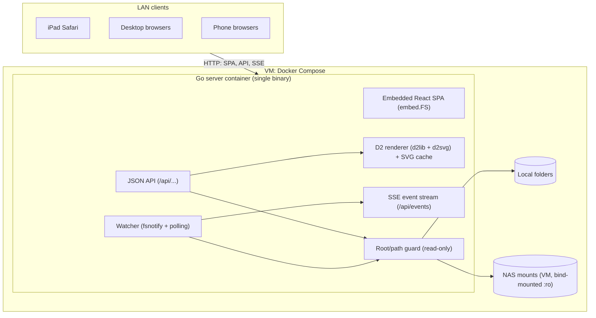
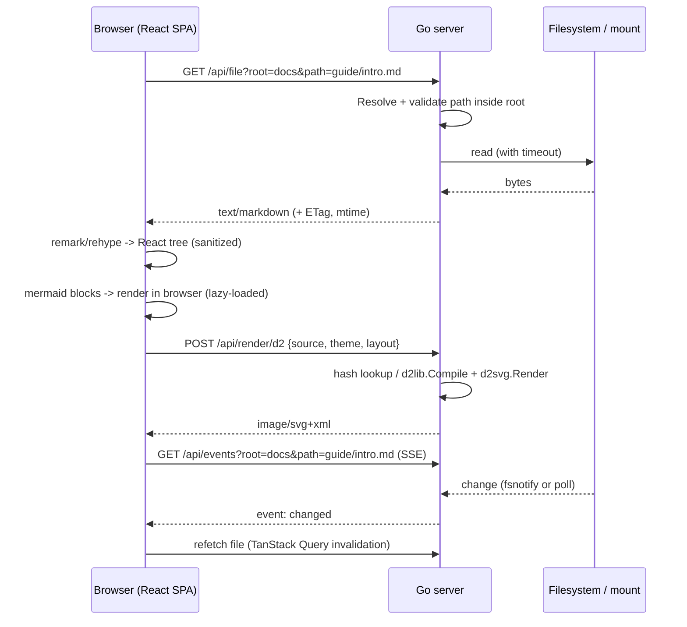

# Project Architecture

## Purpose

High-level architecture for the LAN Markdown viewer. Detailed API contracts and module layout are finalized in the planning phase ([Implementation Plan](./Implementation.md)). This document reflects the Go backend chosen in [Tech Stack](./Tech-Stack.md).

## System Diagram



## Request Flow: Viewing A Markdown File



## Components

| Component | Responsibility |
| --- | --- |
| Config | Loads roots (name → absolute path), listen address, poll interval, size limits, and per-root mount hints (watch vs. poll). |
| Root/path guard | Turns `(root, relative path)` into a real path. Rejects `..`, absolute paths, and symlinks that resolve outside the root. Every file access goes through this. |
| Listing API | Directory entries with type, size, mtime. Paginated or streamed for large folders. Applies timeouts. |
| File API | Serves raw bytes with a content type, ETag/Last-Modified, and range support for media. Serves HTML/SVG files with a restrictive CSP or as attachments. |
| D2 renderer | Compiles D2 source to SVG with dagre/ELK. Bounded concurrency and timeout per render. LRU cache keyed by hash. |
| Watcher + SSE | Subscribes each client to the paths it is viewing. Uses fsnotify on local disks and mtime polling on network mounts. Sends coalesced change events. |
| SPA: Shell | Layout, theme, responsive sidebar drawer, routing (`/view/:root/*`). |
| SPA: Browser | Root list, folder listing, breadcrumbs, filter, workspace tree. |
| SPA: Document view | Markdown pipeline, link/image rewriting, TOC, Mermaid and D2 diagram components, error boundaries. |

## Repository Layout

Go module: `github.com/awesomejt/markdown-viewer`. Binary: `mdv`.

```text
cmd/mdv/main.go            # entrypoint: load config, build server, graceful shutdown
internal/config/           # env + optional YAML config, validation
internal/fsroot/           # Root registry, path guard, listing, file reads with timeouts
internal/d2render/         # D2 compile/render, LRU cache, concurrency limit
internal/watch/            # fsnotify + mtime poller, subscription hub
internal/api/              # HTTP handlers, error model, middleware (slog, recover)
internal/web/              # embed.FS of web/dist + SPA fallback handler
web/                       # Vite + React + TypeScript SPA
  src/api/                 # typed API client + TanStack Query hooks
  src/app/                 # shell, routes, theme, layout
  src/browse/              # roots, listings, breadcrumbs, workspace tree
  src/markdown/            # remark/rehype pipeline, link rewriting, components
  src/diagrams/            # Mermaid + D2 components
  src/live/                # EventSource subscription
e2e/                       # Playwright tests + fixture tree (testdata/)
testdata/fixtures/         # shared Markdown/diagram/symlink fixtures
Dockerfile, compose.yaml, .dockerignore
Makefile                   # build, test, lint, check, docker, e2e
```

## Configuration

Environment variables are the primary source, since they suit Compose. An optional YAML file (`MDV_CONFIG`) uses the same keys in lower case, and env values override it.

| Variable | Default | Meaning |
| --- | --- | --- |
| `MDV_LISTEN` | `:8080` | Listen address. |
| `MDV_ROOTS` | *(required)* | Comma-separated `name=/abs/path[:watch]` entries. `watch` is `poll` (default) or `fsnotify`. Example: `markdown=/data/markdown,notes=/data/notes:fsnotify`. Names match `^[a-z0-9][a-z0-9_-]{0,31}$`. |
| `MDV_POLL_INTERVAL` | `3s` | mtime polling interval for `poll` roots. |
| `MDV_FS_TIMEOUT` | `5s` | Timeout for any single filesystem operation (dead mounts). |
| `MDV_MAX_FILE_BYTES` | `5242880` | Maximum size served by `/api/file` without `?force=1` (applies to text kinds only; media streams). |
| `MDV_D2_TIMEOUT` | `10s` | Per-render timeout. |
| `MDV_D2_CONCURRENCY` | `2` | Concurrent D2 renders. |
| `MDV_D2_CACHE_ENTRIES` | `256` | LRU cache size for rendered SVG. |
| `MDV_LOG_LEVEL` | `info` | `debug`, `info`, `warn`, `error`. |

Startup fails fast if a root is missing, is not a directory, or a name is duplicated.

## HTTP API Contract

All `/api` responses except raw file bodies, SVG, and SSE are JSON. `path` is always relative to the root, uses `/` separators, and `""` means the root itself. The server never returns host paths.

**Error model:** non-2xx JSON responses use `{"error": {"code": "<code>", "message": "<human text>"}}`.

| HTTP | `code` | When |
| --- | --- | --- |
| 400 | `bad_request` | Missing or invalid parameters, malformed path. |
| 403 | `forbidden` | Path escapes the root (traversal or symlink). |
| 404 | `not_found` | Unknown root or path. |
| 413 | `too_large` | Text file over `MDV_MAX_FILE_BYTES` without `force=1`, or D2 source over 256 KiB. |
| 422 | `render_error` | D2 compile failure. The message includes the D2 error text, which contains line/column. |
| 504 | `fs_timeout` | Filesystem operation exceeded `MDV_FS_TIMEOUT`. |
| 500 | `internal` | Anything else. Details are logged, not returned. |

### Endpoints

| Method & path | Response |
| --- | --- |
| `GET /healthz` | `200 {"status":"ok"}` |
| `GET /api/roots` | `{"roots":[{"name":"markdown","watch":"poll"}]}` |
| `GET /api/list?root=&path=` | `{"root","path","entries":[{"name","type":"dir\|file","kind","size","mtime"}]}`. `kind` is one of `markdown` (`.md`, `.markdown`, `.mdx`), `diagram` (`.mmd`, `.mermaid`, `.d2`), `image` (`png jpg jpeg gif webp svg avif`), `text` (known text/code extensions), `other`. `mtime` is RFC 3339. Dot-files are included, and the client filters them. Symlinks are resolved and reported as their target type, and omitted if they escape the root. Sorted dirs first, then by name (case-insensitive). |
| `GET /api/file?root=&path=[&force=1]` | Raw bytes via `http.ServeContent` (Range, ETag from size+mtime, `Last-Modified`, `If-None-Match`). Text kinds are served as `text/plain; charset=utf-8`. Images use their MIME type. `.svg` and `.html` are served with `Content-Security-Policy: sandbox; default-src 'none'; style-src 'unsafe-inline'; img-src data:` and `X-Content-Type-Options: nosniff`. |
| `POST /api/render/d2` | Request `{"source": "...", "theme": "light\|dark", "layout": "dagre\|elk"}`. `layout` defaults to `dagre` (only `dagre` is required in MVP). Response is `image/svg+xml`. The cache key is sha256(source+theme+layout). The response sets `Cache-Control: private, max-age=3600`. |
| `GET /api/events?root=&path=` | SSE stream. `path` may be a file or a directory; a directory watch covers its direct children. Events: `event: change` with `data: {"path":"<rel>","op":"modified\|created\|deleted"}`. A `: ping` comment is sent every 25 s. Events are coalesced per path within 250 ms. |
| `GET /*` | Embedded SPA assets. Unknown non-`/api` paths return `index.html` (history routing). |

### Watch Semantics

- The hub reference-counts subscriptions per `(root, path)` and stops watching when the last subscriber disconnects.
- `poll` roots: every `MDV_POLL_INTERVAL`, stat the watched path. For directories, compare the child set and mtimes. All stats go through `MDV_FS_TIMEOUT`.
- `fsnotify` roots: an inotify watch on the path, or on the parent directory for files, to catch editors that write via rename.

## Frontend Routes

| Route | View |
| --- | --- |
| `/` | Root list. |
| `/browse/:root/*` | Folder listing for the path. |
| `/view/:root/*` | File view chosen by kind: Markdown document, diagram page, image, text, or download. |
| `?ws=<rel-folder>` (on browse/view) | Workspace mode: sidebar tree anchored at that folder, kept while navigating within it. |
| `#<slug>` | Heading anchor within a document. |

**Link rewriting in Markdown:**

- A relative `.md`/diagram link becomes `/view/:root/<resolved>` with `ws` preserved.
- A relative directory link becomes `/browse/...`.
- A relative image or other asset becomes `/api/file?root=&path=<resolved>`.
- Absolute `http(s)`/`mailto` links are left unchanged and open in a new tab.
- Links that resolve outside the root are rendered as plain text with a warning title.

## Security Model

- Trusted LAN, no authentication (owner decision). Read-only. Host paths are never shown to clients, only `root` names and relative paths.
- Markdown HTML is sanitized. Diagram SVG is sanitized or isolated. User-supplied HTML files never run in the app origin.
- Binds to a configured address. The README warns against port-forwarding it or exposing it publicly.
