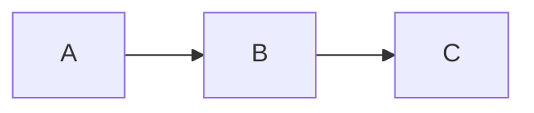

# Broken diagrams

This page is intentionally broken: the invalid blocks should show an error in place, while the valid ones still render.

## Invalid Mermaid

```mermaid
graph TD
  A[Start --> B{Unclosed
  B -->|yes| ((( C
```

## Valid Mermaid (still renders)



## Invalid D2

```d2
server -> db: query
db: {
  shape: cylinder
  style: {
```

## Valid D2 (still renders)

```d2
a -> b -> c
```
