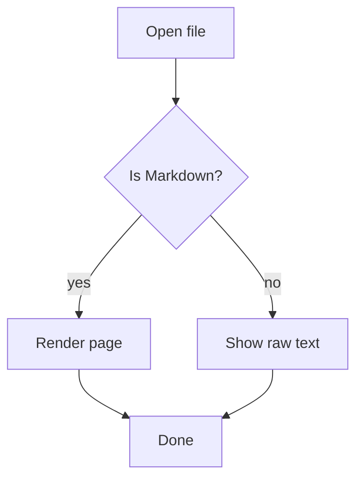
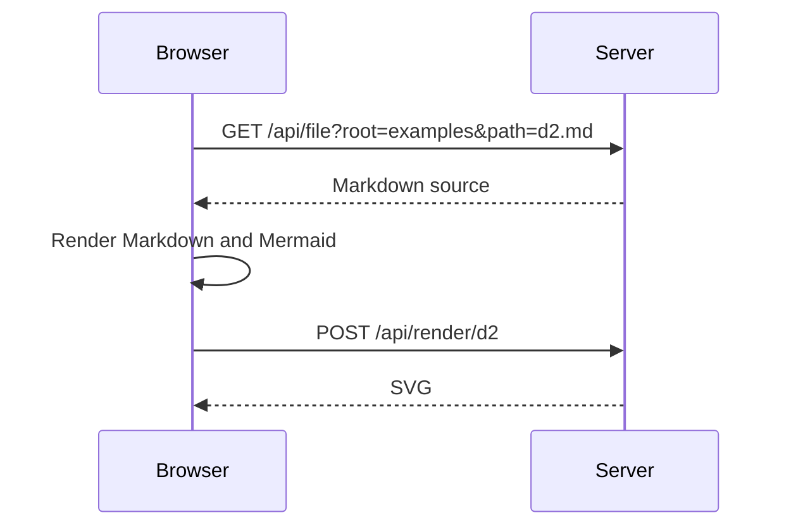
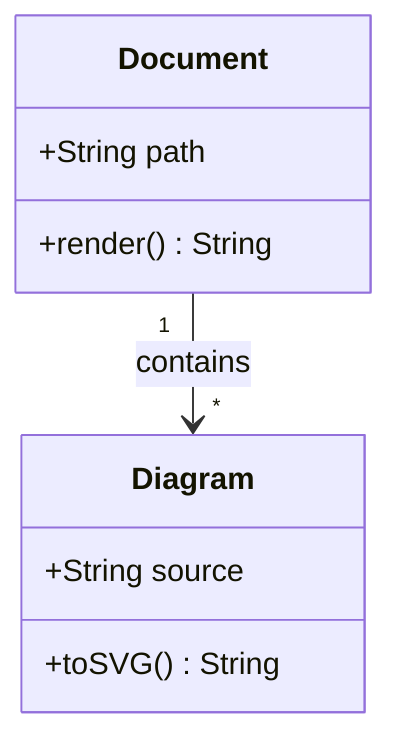
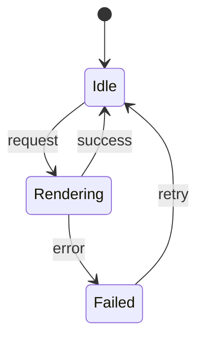
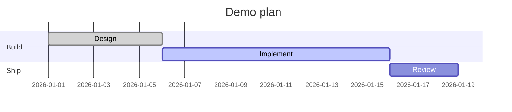

# Mermaid diagrams

Each fenced `mermaid` block is rendered to SVG. A standalone version lives in [flowchart.mmd](flowchart.mmd).

## Flowchart

## Sequence diagram

## Class diagram

## State diagram

## Gantt chart

