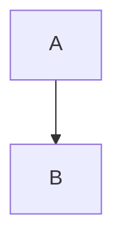

# Inline Diagrams

Valid Mermaid:



Invalid Mermaid:

```mermaid
graph TD
  A --> --> ((
```

Valid D2:

```d2
a -> b
```

Invalid D2:

```d2
a -> {
```

## Slug look-alikes

Headings whose slugs resemble Mermaid temporary ids must survive rendering (FIX-14).

### mdv-mermaid-1

### dmdv-mermaid-2

### mdvMermaid-1

### dmdvMermaid-2
